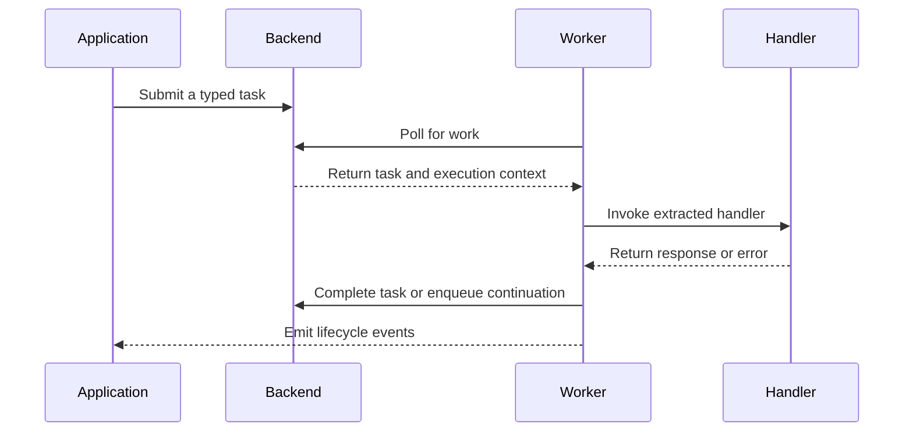
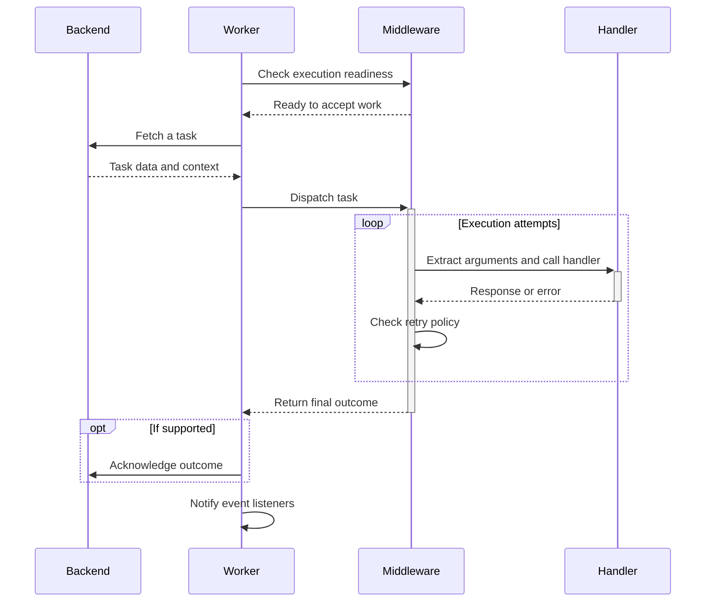

<p align="center">
  
</p>

<h1 align="center">miju</h1>

<div align="center">
  <strong>Typed background task processing and workflow composition for Rust</strong>
</div>

<br />

<div align="center">
  <a href="https://github.com/nanfeng-labs/miju/actions/workflows/ci.yaml">
    
  </a>
  <a href="https://www.rust-lang.org/">
    
  </a>
  <a href="LICENSE">
    
  </a>
</div>

<br />

<div align="center">
  <a href="README.zh-CN.md">简体中文</a>
</div>

## Features

- **Typed task handlers**: write asynchronous functions whose arguments are extracted from task data and worker context.
- **Worker lifecycle management**: configure task sources, middleware, shutdown, and worker coordination.
- **Composable middleware**: apply concurrency and rate limits, timeouts, retries, panic capture, and task transformations.
- **Workflow composition**: build sequential flows and dependency graphs from typed steps.
- **Codec and storage utilities**: encode task data as JSON, MessagePack, or Bincode, or use JSON and CSV file adapters.
- **Optional observability**: integrate tracing, Prometheus metrics, OpenTelemetry metrics and context propagation, or Sentry reporting.

## Crate ecosystem

### Application and core

| Crate | Responsibility |
| --- | --- |
| [`miju`](miju) | Application facade with worker extensions, middleware, configuration, and observability integrations. |
| [`miju-core`](miju-core) | Task types, backend contracts, worker execution, and lifecycle management. |

### Workflow

| Crate | Responsibility |
| --- | --- |
| [`miju-workflow`](miju-workflow) | Typed sequential and graph workflow execution. |

### Data formats and storage

| Crate | Responsibility |
| --- | --- |
| [`miju-codec`](utils/miju-codec) | JSON, MessagePack, and Bincode codecs for task payloads and results. |
| [`miju-file-storage`](utils/miju-file-storage) | JSON and CSV file-backed storage adapters. |

File-backed storage has documented persistence and concurrency limitations. Review the crate documentation before choosing it for an application.

## Installation

Add the facade and an async runtime to your application's `Cargo.toml`:

```toml
[dependencies]
miju = { version = "0.1.0" }
tokio = { version = "1", features = ["macros", "rt-multi-thread"] }

[patch.crates-io]
miju = { git = "https://github.com/nanfeng-labs/miju", branch = "main" }
miju-core = { git = "https://github.com/nanfeng-labs/miju", branch = "main" }
miju-workflow = { git = "https://github.com/nanfeng-labs/miju", branch = "main" }
miju-codec = { git = "https://github.com/nanfeng-labs/miju", branch = "main" }
miju-file-storage = { git = "https://github.com/nanfeng-labs/miju", branch = "main" }
```

The patch entries resolve the workspace crates from one repository revision. Add `miju-workflow`, `miju-codec`, or `miju-file-storage` to `[dependencies]` when your application uses them. Pin a Git revision instead of `main` when you need reproducible dependency resolution.

## Usage

Submit a typed task to an in-memory backend and stop the worker after it handles the task:

```rust
use miju::prelude::*;

async fn handle(value: u32, worker: WorkerContext) -> Result<(), BoxDynError> {
    assert_eq!(value, 42);
    worker.stop()?;
    Ok(())
}

#[tokio::main]
async fn main() -> Result<(), BoxDynError> {
    let mut backend = MemoryStorage::new();
    backend.push(42u32).await?;

    WorkerBuilder::new("example")
        .backend(backend)
        .build(handle)
        .run()
        .await?;

    Ok(())
}
```

`MemoryStorage` is process-local. Choose a backend based on the durability, task management, and lifecycle guarantees your application needs.

## Workflows

`miju-workflow` adds sequential flows and dependency graphs. Sequential steps pass typed results to the next step; graph workflows schedule dependent nodes and collect results when branches converge. See the [`miju-workflow` guide](miju-workflow/README.md) for examples and current behavior.

## Examples

| Example | Scenario | Run |
| --- | --- | --- |
| [`basic`](examples/basic) | Process an in-memory task with rate limiting, concurrency, retries, panic capture, task spawning, and tracing. | `cargo run -p basic --locked` |
| [`catch-panic`](examples/catch-panic) | Capture deliberate email-task panics, exclude abort errors from retries, and observe worker error events. | `cargo run -p catch-panic --locked` |
| [`graceful-shutdown`](examples/graceful-shutdown) | Respond to Ctrl+C, finish a batch, and simulate saving task state before shutdown. | `cargo run -p graceful-shutdown --locked` |
| [`long-running`](examples/long-running) | Run concurrent data exports with `TaskRunner`, collect their results, and drain active work on shutdown. | `cargo run -p long-running --locked` |

Run these commands from the repository root. Each example contains its own `Cargo.toml` and `src/main.rs`, with the required features and execution comments.

`basic` exits after processing its task. The other examples keep the worker running until **Ctrl+C**. `catch-panic` deliberately prints panic-hook messages before reporting captured errors; it does not send email. `graceful-shutdown` checks for shutdown between five-second batches, then spends five seconds simulating a checkpoint without writing data. `long-running` simulates three exports lasting eight to twelve seconds; Ctrl+C waits for the active export to finish and its results to be collected.

## How miju works



Backend capabilities determine how tasks are stored, completed, observed, and queried. Middleware wraps task execution, while a monitor coordinates multiple workers.

### Task execution in detail

The worker passes each task from its backend through middleware to the application handler. The following diagram follows one task through a worker configured with rate limiting, concurrency control, and retries.



**Fetching work.** The worker fetches a task only when both the backend and the execution pipeline are ready. Rate limiting controls how frequently tasks start, while concurrency limiting bounds the number being processed at once. When either limit is reached, the worker waits before fetching more work.

**Execution and retries.** Requests enter middleware in the order the layers were added; responses return in reverse order. On failure, the retry layer checks the error, remaining attempts, and task and worker state before calling the inner handler again. These retries happen within the worker without re-enqueuing the task. In [`basic`](examples/basic/src/main.rs), rate and concurrency limits wrap retry, while tracing sits inside it: retries retain the task's concurrency slot, and each attempt gets its own span.

**Completion and shutdown.** Once processing reaches a final outcome, the backend performs any acknowledgement or result storage it supports, and the worker reports success or failure through `on_event`. During normal shutdown, the worker stops fetching tasks and waits for active work and backend cleanup. Handlers that need to save progress can check `WorkerContext::is_shutting_down()` and finish their cleanup, as shown in [`graceful-shutdown`](examples/graceful-shutdown/src/main.rs).

## Observability

Enable the facade feature for the telemetry system used by your application:

| Feature | Integration |
| --- | --- |
| `tracing` | Worker lifecycle events and task-processing spans. |
| `prometheus` | Task counts and processing durations. |
| `opentelemetry` | Metrics and tracing-context propagation. |
| `sentry` | Task error and transaction reporting. |

The default feature set includes `tracing`. The other integrations are opt-in. The `sentry` and `full` features require Rust 1.89 because they enable UUID task IDs. The default workspace MSRV is Rust 1.85; UUID and ULID task-ID support in `miju-core` also requires Rust 1.89. Core serialization is enabled with `miju-core/serde`.

## License

miju is licensed under the [MIT License](LICENSE).
