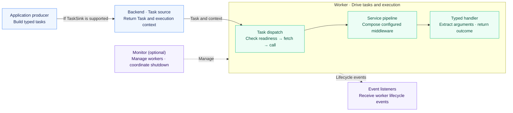
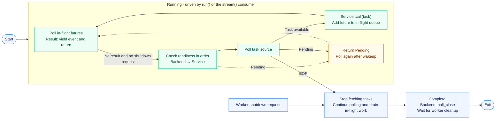

<p align="center">
  
</p>

<h1 align="center">miju</h1>

<div align="center">
  <strong>Typed background task processing and workflow composition for Rust</strong>
</div>

<br />

<div align="center">
  <a href="https://crates.io/crates/miju">
    
  </a>
  <a href="https://docs.rs/miju">
    
  </a>
  <a href="https://github.com/nanfeng-labs/miju/actions/workflows/ci.yaml">
    
  </a>
  <a href="https://www.rust-lang.org/">
    
  </a>
  <a href="LICENSE">
    
  </a>
</div>

<br />

<div align="center">
  <a href="README.zh-CN.md">简体中文</a>
</div>

<br />

## Features

- **Typed task handlers**: write asynchronous functions whose arguments are extracted from task data and worker context.
- **Worker lifecycle management**: configure task sources, middleware, shutdown, and worker coordination.
- **Composable middleware**: apply concurrency and rate limits, timeouts, retries, panic capture, and task transformations.
- **Workflow composition**: build sequential flows and dependency graphs from typed steps.
- **Codec and storage utilities**: encode task data as JSON, MessagePack, or Bincode, or use JSON and CSV file adapters.
- **Optional observability**: integrate tracing, Prometheus metrics, OpenTelemetry metrics and context propagation, or Sentry reporting.

## Crate ecosystem

### Application and core

| Crate | Responsibility |
| --- | --- |
| [`miju`](miju) | Application facade with worker extensions, middleware, configuration, and observability integrations. |
| [`miju-core`](miju-core) | Task types, backend contracts, worker execution, and lifecycle management. |

### Workflow

| Crate | Responsibility |
| --- | --- |
| [`miju-workflow`](miju-workflow) | Typed sequential and graph workflow execution. |

### Data formats and storage

| Crate | Responsibility |
| --- | --- |
| [`miju-codec`](utils/miju-codec) | JSON, MessagePack, and Bincode codecs for task payloads and results. |
| [`miju-file-storage`](utils/miju-file-storage) | JSON and CSV file-backed storage adapters. |

File-backed storage has documented persistence and concurrency limitations. Review the crate documentation before choosing it for an application.

## Installation

Add the facade and an async runtime to your application's `Cargo.toml`:

```toml
[dependencies]
miju = { version = "0.2.0" }
tokio = { version = "1", features = ["macros", "rt-multi-thread"] }

# Optional: workflows, codecs, and file storage
# miju-workflow = { version = "0.2.0" }
# miju-codec = { version = "0.2.0" }
# miju-file-storage = { version = "0.2.0" }
```

## Usage

Submit a typed task to an in-memory backend and stop the worker after it handles the task:

```rust
use miju::prelude::*;

async fn handle(value: u32, worker: WorkerContext) -> Result<(), BoxDynError> {
    assert_eq!(value, 42);
    worker.stop()?;
    Ok(())
}

#[tokio::main]
async fn main() -> Result<(), BoxDynError> {
    let mut backend = MemoryStorage::new();
    backend.push(42u32).await?;

    WorkerBuilder::new("example")
        .backend(backend)
        .build(handle)
        .run()
        .await?;

    Ok(())
}
```

`MemoryStorage` is process-local. Choose a backend based on the durability, task management, and lifecycle guarantees your application needs.

## Workflows

`miju-workflow` adds sequential flows and dependency graphs. Sequential steps pass typed results to the next step; graph workflows schedule dependent nodes and collect results when branches converge. See the [`miju-workflow` guide](miju-workflow/README.md) for examples and current behavior.

## Examples

Start with [`basic`](examples/basic) to see task processing and middleware in action. Run it from the repository root:

```sh
cargo run -p basic --locked
```

Browse the [example guide](examples/README.md) for dependency injection, worker context, panic handling, and shutdown scenarios, with instructions for running and stopping each example.

## How miju works



Solid arrows show task flow; dotted arrows show management or event relationships. Response paths are omitted. Backends implementing `TaskSink` accept submitted tasks; other backends can generate tasks directly. Persistence, acknowledgement, result storage, and workflow continuations depend on the integration. Workers drive the configured execution pipeline; an optional monitor coordinates multiple workers.

### Task execution in detail

The following diagram shows task dispatch, waiting, and normal shutdown. Polling by `run()` or the consumer of `stream()` drives execution. Error exits and forced termination are not shown.



**Driving and fetching work.** The worker polls in-flight futures first. A completed result yields an event and ends the current poll. If no result is ready and shutdown has not been requested, it checks backend readiness, then service readiness, before fetching a task. Calling the pipeline adds its future to the in-flight queue; fetching another task does not require the previous one to finish. Rate limiting controls how frequently tasks start, while concurrency limiting bounds the number being processed at once. When either limit is reached, the worker waits before fetching more work.

**Execution and retries.** Requests enter middleware in the order the layers were added; responses return in reverse order. On failure, the retry layer checks the error, remaining attempts, and task and worker state before calling the inner handler again. These retries happen within the worker without re-enqueuing the task. In [`basic`](examples/basic/src/main.rs), rate and concurrency limits wrap retry, while tracing sits inside it: retries retain the task's concurrency slot, and each attempt gets its own span.

**Waiting and exhaustion.** `Pending` means execution cannot currently advance; the worker waits for a wakeup before polling again. EOF means the task source has ended and starts draining.

**Completion and shutdown.** Configured backend integrations can provide acknowledgement or result storage, and the worker reports success or failure through `on_event`. On normal shutdown or backend EOF, the worker stops fetching tasks, drains in-flight work, completes `Backend::poll_close`, waits for worker cleanup, and emits `Exit`. Handlers that need to save progress can check `WorkerContext::is_shutting_down()` and finish their cleanup, as shown in [`graceful-shutdown`](examples/graceful-shutdown/src/main.rs).

## Observability

Enable the facade feature for the telemetry system used by your application:

| Feature | Integration |
| --- | --- |
| `tracing` | Worker lifecycle events and task-processing spans. |
| `prometheus` | Task counts and processing durations. |
| `opentelemetry` | Metrics and tracing-context propagation. |
| `sentry` | Task error and transaction reporting. |

The default feature set includes `tracing`. The other integrations are opt-in. The `sentry` and `full` features require Rust 1.89 because they enable UUID task IDs. The default workspace MSRV is Rust 1.85; UUID and ULID task-ID support in `miju-core` also requires Rust 1.89. Core serialization is enabled with `miju-core/serde`.

## License

miju is licensed under the [MIT License](LICENSE).
