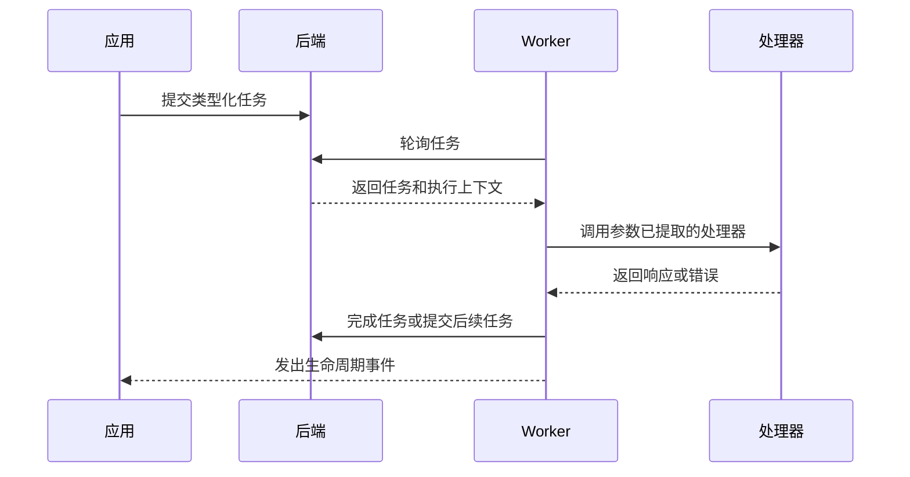
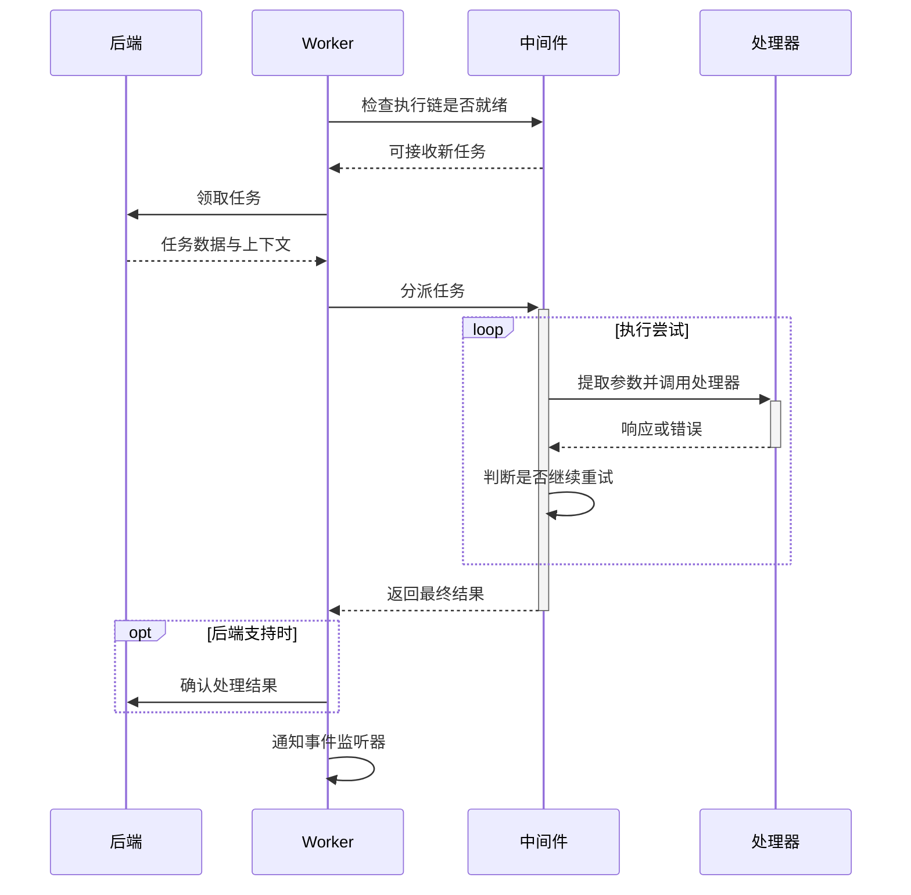

<p align="center">
  
</p>

<h1 align="center">miju</h1>

<div align="center">
  <strong>面向 Rust 的类型化后台任务处理与工作流组合</strong>
</div>

<br />

<div align="center">
  <a href="https://github.com/nanfeng-labs/miju/actions/workflows/ci.yaml">
    
  </a>
  <a href="https://www.rust-lang.org/">
    
  </a>
  <a href="LICENSE">
    
  </a>
</div>

<br />

<div align="center">
  <a href="README.md">English</a>
</div>

## 特性

- **类型化任务处理器**：编写异步函数，参数从任务数据和 worker 上下文中提取。
- **Worker 生命周期管理**：配置任务来源、中间件、关闭流程和 worker 协调。
- **可组合中间件**：应用并发与速率限制、超时、重试、panic 捕获和任务转换。
- **工作流组合**：通过类型化步骤构建顺序流程和依赖图。
- **编解码与存储工具**：使用 JSON、MessagePack 或 Bincode 编解码，也可使用 JSON 和 CSV 文件适配器。
- **可选可观测性**：接入 tracing、Prometheus 指标、OpenTelemetry 指标与上下文传播，或 Sentry 上报。

## Crate 生态

### 应用与核心

| Crate | 职责 |
| --- | --- |
| [`miju`](miju) | 面向应用的门面，提供 worker 扩展、中间件、配置和可观测性集成。 |
| [`miju-core`](miju-core) | 任务类型、后端契约、worker 执行和生命周期管理。 |

### 工作流

| Crate | 职责 |
| --- | --- |
| [`miju-workflow`](miju-workflow) | 类型化顺序流程与依赖图执行。 |

### 数据格式与存储

| Crate | 职责 |
| --- | --- |
| [`miju-codec`](utils/miju-codec) | 用于任务载荷和结果的 JSON、MessagePack 与 Bincode 编解码器。 |
| [`miju-file-storage`](utils/miju-file-storage) | JSON 和 CSV 文件存储适配器。 |

文件存储对持久化和并发有明确限制。用于应用前，请先阅读对应 crate 文档。

## 安装

在应用的 `Cargo.toml` 中添加门面和异步运行时依赖：

```toml
[dependencies]
miju = { version = "0.1.0" }
tokio = { version = "1", features = ["macros", "rt-multi-thread"] }

[patch.crates-io]
miju = { git = "https://github.com/nanfeng-labs/miju", branch = "main" }
miju-core = { git = "https://github.com/nanfeng-labs/miju", branch = "main" }
miju-workflow = { git = "https://github.com/nanfeng-labs/miju", branch = "main" }
miju-codec = { git = "https://github.com/nanfeng-labs/miju", branch = "main" }
miju-file-storage = { git = "https://github.com/nanfeng-labs/miju", branch = "main" }
```

这些 patch 会让各个 workspace crate 从同一个仓库修订版解析。使用工作流、编解码或文件存储时，将对应 crate 添加到 `[dependencies]`。需要可复现的依赖解析时，请使用固定 Git revision 替代 `main`。

## 用法

将类型化任务提交到内存后端，并在处理完任务后停止 worker：

```rust
use miju::prelude::*;

async fn handle(value: u32, worker: WorkerContext) -> Result<(), BoxDynError> {
    assert_eq!(value, 42);
    worker.stop()?;
    Ok(())
}

#[tokio::main]
async fn main() -> Result<(), BoxDynError> {
    let mut backend = MemoryStorage::new();
    backend.push(42u32).await?;

    WorkerBuilder::new("example")
        .backend(backend)
        .build(handle)
        .run()
        .await?;

    Ok(())
}
```

`MemoryStorage` 仅存在于当前进程。请根据应用所需的持久性、任务管理和生命周期保证选择后端。

## 工作流

`miju-workflow` 提供顺序流程与依赖图。顺序步骤把类型化结果传给后续步骤；图工作流调度依赖节点，并在分支汇合时收集结果。示例和当前行为详见 [`miju-workflow` 指南](miju-workflow/README.md)。

## 示例

| 示例 | 场景 | 运行命令 |
| --- | --- | --- |
| [`basic`](examples/basic) | 使用速率限制、并发、重试、panic 捕获、任务 spawn 和 tracing 处理内存任务。 | `cargo run -p basic --locked` |
| [`catch-panic`](examples/catch-panic) | 捕获邮件任务中主动触发的 panic，排除中止错误的重试，并观测 worker 错误事件。 | `cargo run -p catch-panic --locked` |
| [`graceful-shutdown`](examples/graceful-shutdown) | 响应 Ctrl+C，完成当前批次，并在关闭前模拟保存任务状态。 | `cargo run -p graceful-shutdown --locked` |
| [`long-running`](examples/long-running) | 通过 `TaskRunner` 并发执行数据导出、收集结果，并在关闭时等待执行中的任务完成。 | `cargo run -p long-running --locked` |

请在仓库根目录运行这些命令。每个示例均包含独立的 `Cargo.toml` 和 `src/main.rs`，展示所需 feature 和执行过程的注释。

`basic` 处理完任务后自动退出，其他示例会保持 worker 运行，直到按下 **Ctrl+C**。`catch-panic` 会先打印 panic hook 信息，再上报捕获到的错误，不会发送邮件。`graceful-shutdown` 在每个五秒批次结束后检查关闭状态，再用五秒模拟检查点保存，不会实际写入数据。`long-running` 模拟三个耗时八至十二秒的导出操作；按下 Ctrl+C 后，会等待当前导出完成并收集结果。

## miju 的运行方式



后端能力决定任务如何存储、完成、观测和查询。中间件包裹任务执行，monitor 可协调多个 worker。

### 任务执行详解

Worker 将从后端领取的任务交给中间件，最终调用业务处理器。下面以配置了限流、并发限制和重试的 worker 为例，展示一次任务处理的过程。



**领取任务。** Worker 在后端和执行链都就绪后才领取任务。速率限制控制任务开始的频率，并发限制控制同时处理的任务数量；当额度或名额耗尽时，worker 会等待其恢复后再领取任务。

**执行与重试。** 请求按中间件的添加顺序进入，响应按相反顺序返回。执行失败时，重试层根据错误、剩余次数和任务及 worker 状态决定是否再次调用内层处理器。重试在当前 worker 中完成，无需重新入队。[`basic`](examples/basic/src/main.rs) 将限流和并发限制放在 retry 外层，将 tracing 放在内层：同一任务重试时沿用并发名额，每次尝试都有独立的 span。

**完成与关闭。** 任务返回最终结果后，后端执行其支持的完成确认或结果保存，worker 通过 `on_event` 通知成功或错误。正常关闭时，worker 停止领取新任务，等待执行中的任务与后端清理完成。需要保存业务进度的处理器可通过 `WorkerContext::is_shutting_down()` 检测关闭请求并收尾，见 [`graceful-shutdown`](examples/graceful-shutdown/src/main.rs)。

## 可观测性

启用与应用遥测系统对应的门面 feature：

| Feature | 集成能力 |
| --- | --- |
| `tracing` | Worker 生命周期事件和任务处理 span。 |
| `prometheus` | 任务数量和处理耗时。 |
| `opentelemetry` | 指标和 tracing 上下文传播。 |
| `sentry` | 任务错误和 transaction 上报。 |

默认 feature 集包含 `tracing`，其他集成需要显式启用。`sentry` 和 `full` 会启用 UUID task ID，因此需要 Rust 1.89。默认 workspace MSRV 为 Rust 1.85；`miju-core` 的 UUID 与 ULID task ID 支持也需要 Rust 1.89。核心序列化能力通过 `miju-core/serde` 启用。

## 许可证

miju 采用 [MIT License](LICENSE) 授权。
