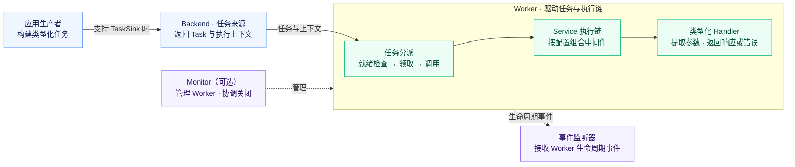
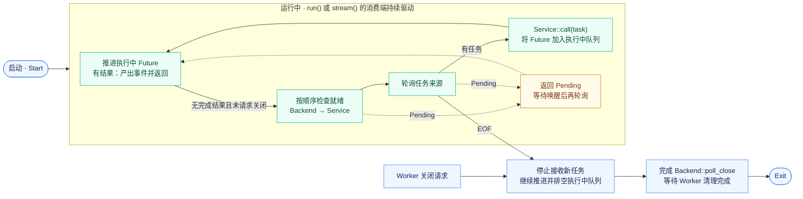

<p align="center">
  
</p>

<h1 align="center">miju</h1>

<div align="center">
  <strong>面向 Rust 的类型化后台任务处理与工作流组合</strong>
</div>

<br />

<div align="center">
  <a href="https://crates.io/crates/miju">
    
  </a>
  <a href="https://docs.rs/miju">
    
  </a>
  <a href="https://github.com/nanfeng-labs/miju/actions/workflows/ci.yaml">
    
  </a>
  <a href="https://www.rust-lang.org/">
    
  </a>
  <a href="LICENSE">
    
  </a>
</div>

<br />

<div align="center">
  <a href="README.md">English</a>
</div>

<br />

## 特性

- **类型化任务处理器**：编写异步函数，参数从任务数据和 worker 上下文中提取。
- **Worker 生命周期管理**：配置任务来源、中间件、关闭流程和 worker 协调。
- **可组合中间件**：应用并发与速率限制、超时、重试、panic 捕获和任务转换。
- **工作流组合**：通过类型化步骤构建顺序流程和依赖图。
- **编解码与存储工具**：使用 JSON、MessagePack 或 Bincode 编解码，也可使用 JSON 和 CSV 文件适配器。
- **可选可观测性**：接入 tracing、Prometheus 指标、OpenTelemetry 指标与上下文传播，或 Sentry 上报。

## Crate 生态

### 应用与核心

| Crate | 职责 |
| --- | --- |
| [`miju`](miju) | 面向应用的门面，提供 worker 扩展、中间件、配置和可观测性集成。 |
| [`miju-core`](miju-core) | 任务类型、后端契约、worker 执行和生命周期管理。 |

### 工作流

| Crate | 职责 |
| --- | --- |
| [`miju-workflow`](miju-workflow) | 类型化顺序流程与依赖图执行。 |

### 数据格式与存储

| Crate | 职责 |
| --- | --- |
| [`miju-codec`](utils/miju-codec) | 用于任务载荷和结果的 JSON、MessagePack 与 Bincode 编解码器。 |
| [`miju-file-storage`](utils/miju-file-storage) | JSON 和 CSV 文件存储适配器。 |

文件存储对持久化和并发有明确限制。用于应用前，请先阅读对应 crate 文档。

## 安装

在应用的 `Cargo.toml` 中添加门面和异步运行时依赖：

```toml
[dependencies]
miju = { version = "0.2.0" }
tokio = { version = "1", features = ["macros", "rt-multi-thread"] }

# 可选：工作流、编解码与文件存储
# miju-workflow = { version = "0.2.0" }
# miju-codec = { version = "0.2.0" }
# miju-file-storage = { version = "0.2.0" }
```

## 用法

将类型化任务提交到内存后端，并在处理完任务后停止 worker：

```rust
use miju::prelude::*;

async fn handle(value: u32, worker: WorkerContext) -> Result<(), BoxDynError> {
    assert_eq!(value, 42);
    worker.stop()?;
    Ok(())
}

#[tokio::main]
async fn main() -> Result<(), BoxDynError> {
    let mut backend = MemoryStorage::new();
    backend.push(42u32).await?;

    WorkerBuilder::new("example")
        .backend(backend)
        .build(handle)
        .run()
        .await?;

    Ok(())
}
```

`MemoryStorage` 仅存在于当前进程。请根据应用所需的持久性、任务管理和生命周期保证选择后端。

## 工作流

`miju-workflow` 提供顺序流程与依赖图。顺序步骤把类型化结果传给后续步骤；图工作流调度依赖节点，并在分支汇合时收集结果。示例和当前行为详见 [`miju-workflow` 指南](miju-workflow/README.md)。

## 示例

从 [`basic`](examples/basic) 了解任务处理与中间件的组合方式。在仓库根目录运行：

```sh
cargo run -p basic --locked
```

更多依赖注入、worker 上下文、panic 处理和关闭场景，以及各示例的运行与退出说明，见[示例指南](examples/README.zh-CN.md)。

## miju 的运行方式



实线表示任务流向，虚线表示管理或事件关系；响应返回路径未展开。支持 `TaskSink` 的后端允许应用提交任务，其他后端也可以直接生成任务。持久化、完成确认、结果存储和工作流续接取决于具体集成。Worker 驱动配置好的执行链，Monitor 则可选地协调多个 worker。

### 任务执行详解

下图展示 Worker 的任务调度、等待与正常关闭过程。`run()` 或 `stream()` 的消费端持续轮询，推动任务执行；错误退出与强制终止路径未展开。



**推进与领取。** Worker 优先推进执行中的 Future；有完成结果时，产出事件并结束本次轮询。没有完成结果且未请求关闭时，依次检查后端和执行链是否就绪，再领取任务。调用执行链后，返回的 Future 加入执行中队列，无需等该任务完成才领取下一项。速率限制控制任务开始的频率，并发限制控制同时处理的任务数量；当额度或名额耗尽时，worker 会等待其恢复后再领取任务。

**执行与重试。** 请求按中间件的添加顺序进入，响应按相反顺序返回。执行失败时，重试层根据错误、剩余次数和任务及 worker 状态决定是否再次调用内层处理器。重试在当前 worker 中完成，无需重新入队。[`basic`](examples/basic/src/main.rs) 将限流和并发限制放在 retry 外层，将 tracing 放在内层：同一任务重试时沿用并发名额，每次尝试都有独立的 span。

**等待与结束。** `Pending` 表示当前无法继续推进，Worker 等待唤醒后再次轮询；EOF 表示任务来源结束，进入排空流程。

**完成与关闭。** 配置的后端集成可提供完成确认或结果保存，worker 通过 `on_event` 通知成功或错误。正常关闭或后端 EOF 后，Worker 停止领取新任务，排空执行中队列，完成 `Backend::poll_close`，再等待 Worker 清理完成并发出 `Exit`。需要保存业务进度的处理器可通过 `WorkerContext::is_shutting_down()` 检测关闭请求并收尾，见 [`graceful-shutdown`](examples/graceful-shutdown/src/main.rs)。

## 可观测性

启用与应用遥测系统对应的门面 feature：

| Feature | 集成能力 |
| --- | --- |
| `tracing` | Worker 生命周期事件和任务处理 span。 |
| `prometheus` | 任务数量和处理耗时。 |
| `opentelemetry` | 指标和 tracing 上下文传播。 |
| `sentry` | 任务错误和 transaction 上报。 |

默认 feature 集包含 `tracing`，其他集成需要显式启用。`sentry` 和 `full` 会启用 UUID task ID，因此需要 Rust 1.89。默认 workspace MSRV 为 Rust 1.85；`miju-core` 的 UUID 与 ULID task ID 支持也需要 Rust 1.89。核心序列化能力通过 `miju-core/serde` 启用。

## 许可证

miju 采用 [MIT License](LICENSE) 授权。
