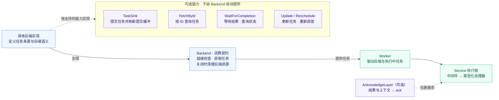
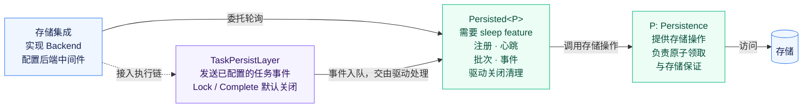

<p align="center">
  
</p>

<h1 align="center">miju-core</h1>

<br />

<div align="center">
  <a href="README.md">English</a>
</div>

<br />

为 Rust 后台处理提供任务后端与 Worker 执行能力。

`miju-core` 提供任务数据结构、后端协议、Worker 和监控能力。Worker 通过中间件与生命周期跟踪来执行处理器；后端提供任务，并定义自身的存储能力。

## 核心概念

- **[任务](#任务)**：类型安全的任务数据结构，包含处理元数据
- **[后端](#后端)**：任务来源、提交与存储契约
- **[Worker](#worker)**：处理器执行与生命周期控制
- **[Monitor](#monitor)**：协调多个 Worker、关闭与重启策略

### 任务

任务结构体为任务数据和元数据提供类型安全的组件：

- [`Args`](src/task/task_fn.rs) - 任务的主要数据结构
- [`ExecutionContext`](src/task/mod.rs) - 后端持久化的任务执行信息
- [`Status`](src/task/status.rs) - 任务的当前状态
- [`TaskId`](src/task/task_id.rs) - 用于跟踪任务的唯一标识符
- [`Attempt`](src/task/attempt.rs) - 重试跟踪与执行尝试信息
- [`Extensions`](src/task/extensions.rs) - 以类型安全的方式存储附加任务数据
- [`Metadata`](src/task/metadata.rs) - 与任务关联的元数据

#### 示例：使用 `TaskBuilder`

```rust
use miju_core::task::{Task, builder::TaskBuilder};

let task: Task<String> = TaskBuilder::new("my-task".to_string())
    .task_id("task-123".to_string().into())
    .max_attempts(3)
    .run_in_minutes(10)
    .build();
```

任务的详细说明见 [`task`](src/task/mod.rs) 和 [`task::builder`](src/task/builder.rs) 模块。

##### 相关指南

- [**定义任务参数**](src/task/task_fn.rs) - 创建可扩展且类型安全的任务参数

### 后端

[`backend`](src/backend/mod.rs) 模块定义了用于轮询任务的 [`Backend`](src/backend/mod.rs)、用于提交任务的 [`TaskSink`](src/backend/mod.rs)，以及管理能力。
[`MemoryStorage`](src/backend/impls/memory.rs)、[`VecDequeBackend`](src/backend/impls/dequeue.rs) 和 [`CustomBackend`](src/backend/custom.rs) 提供任务来源。
[`Codec`](src/backend/codec.rs) 与 [`FinalizeBackend`](src/backend/finalize.rs) 将编码后的载荷连接到类型化处理器。

[`BackendExt`](src/backend/ext/mod.rs) 增加错误检查与映射、生命周期回调、任务管道、流交错组合和轮询策略。
策略提供唤醒并收集轮询统计信息，不会限制对底层后端的调用。启用 `sleep` 可使用固定间隔与退避策略，启用 `tracing` 可进行 span 插桩，启用 `shared` 可使用可克隆的后端句柄。

#### 后端能力



`Backend` 定义消费契约：就绪检查、任务交付和关闭清理。Worker 轮询这一契约，并推进执行中的任务。
以下附加接口代表不同的能力，并不要求每个后端都提供所有操作。

- **提交与管理。** `TaskSink` 提交任务并驱动提交缓冲；`Update` 和 `Reschedule` 管理已有任务。这些接口本身不提供持久化存储保证。
- **任务与结果查询。** `FetchById` 按 ID 获取任务。`WaitForCompletion` 以流的形式提供执行结果，或查询其当前状态；它本身不执行任务，也不存储结果。
- **完成确认。** 可选的 `AcknowledgeLayer` 包裹服务，将执行结果和执行上下文传给 `Acknowledge::ack`。确认器与存储集成决定是否记录结果以及如何记录。添加这一层不会自动获得结果查询能力。

#### 持久化集成

启用 `sleep` 后，`backend::persistence` 提供 `Persistence` provider 契约和 `Persisted<P>` 驱动。
驱动协调注册、心跳、任务批次、事件处理和关闭清理；它本身不实现 `Backend`。



存储集成实现 `Backend`，将轮询委托给驱动，并通过后端中间件配置接入它的 `TaskPersistLayer`。
事件层的任务加锁和结果持久化选项默认关闭；启用后分别发送 `Lock` 和 `Complete` 事件。即使两个选项都关闭，任务也必须具有 ID。

发送事件只会将其加入队列。必须持续轮询驱动，才能通过 provider 将事件应用到存储。锁事件入队并不意味着已获得任务的独占所有权。
Provider 实现实际存储操作，并负责原子任务领取、一致性和持久性。

当多个 Worker 重复初始化中间件时，`Persisted::shared_layer` 复用同一驱动的事件通道。
克隆 `Persisted` 会重置其本地轮询、提交和事件通道状态；是否共享存储取决于 provider 自身的 `Clone` 实现。

### Worker

Worker 是从后端获取并处理任务的执行引擎。使用 [`WorkerBuilder`](src/worker/builder.rs) 为其配置后端、中间件和任务处理器。

```rust
use miju_core::backend::{TaskSink, memory::MemoryStorage};
use miju_core::worker::{builder::WorkerBuilder, context::WorkerContext};
#[tokio::main]
async fn main() {
    let mut backend = MemoryStorage::new();
    backend.push(42u32).await.unwrap();
    let worker = WorkerBuilder::new("example").backend(backend).build(
        |value: u32, worker: WorkerContext| async move {
            assert_eq!(value, 42);
            worker.stop().unwrap();
        },
    );
    worker.run().await.unwrap();
}
```

[`WorkerContext`](src/worker/context.rs) 控制暂停、恢复和关闭。生命周期跟踪会记录执行尝试次数和任务状态。
处理器错误会转化为 Worker 事件；归类为重试的错误会更新状态，但不会自动将任务重新入队。
后端返回 EOF 时，Worker 会排空执行中的任务并完成后端清理，然后停止其上下文并完成关闭。

### Monitor

[`Monitor`](src/monitor/mod.rs) 管理多个 Worker、协调关闭，并可按指定策略重启失败的 Worker。
正常关闭会等待已跟踪的任务排空。配置的 terminator 可以提前结束等待，见 [`Monitor::run_with_signal`](src/monitor/mod.rs)。

启用 `task-context` 可跟踪和取消单个任务，启用 `sleep` 可为任务与关闭过程设置基于定时器的限制，启用 `tracing` 可记录生命周期日志。
启用 `test-utils` 可使用任务函数签名验证辅助工具。默认 feature 集仍为空。

#### 示例：将 `Monitor` 与 Worker 配合使用

```rust
use miju_core::backend::{TaskSink, dequeue::VecDequeBackend};
use miju_core::monitor::Monitor;
use miju_core::task::Task;
use miju_core::worker::builder::WorkerBuilder;
use miju_core::worker::context::WorkerContext;
use std::time::Duration;
use tower::service_fn;
#[tokio::main]
async fn main() {
    let mut storage = VecDequeBackend::new();
    storage.push(1u32).await.unwrap();

    let monitor = Monitor::new()
        .on_event(|worker, event| println!("{}: {:?}", worker.name(), event))
        .register(move |_| {
            WorkerBuilder::new("demo-worker")
                .backend(storage.clone())
                .build(|req: u32, worker: WorkerContext| async move {
                    println!("Processing task: {:?}", req);
                    worker.stop().unwrap();
                    Ok::<_, std::io::Error>(req)
                })
        });

    // Start monitor and run all registered workers
    monitor.run().await.unwrap();
}
```

### 中间件

`miju-core` 基于 `tower` 生态，支持用于错误处理、超时、限流和可观测性的中间件。

#### 核心中间件

以下中间件层及其 Worker 扩展已内置：

- [`AcknowledgeLayer`](src/worker/ext/ack/mod.rs) - 任务处理后的完成确认
- [`EventListenerLayer`](src/worker/ext/event_listener/mod.rs) - Worker 事件的发出与处理
- [`CircuitBreakerLayer`](src/worker/ext/circuit_breaker/mod.rs) - 通过熔断处理故障
- [`LongRunningLayer`](src/worker/ext/long_running/mod.rs) - 支持跟踪长时间运行的任务

#### 通过中间件扩展

可以编写自定义中间件，在任务处理前后执行代码。

<details>
<summary>创建自定义中间件</summary>

下面是一个简单的日志中间件层示例：

```rust
use miju_core::task::Task;
use std::task::{Context, Poll};
use tower::{Layer, Service};

// Define a logging service that wraps another service
pub struct LoggingService<S> {
    inner: S,
}

impl<S, Args, Res, Err> Service<Task<Args>> for LoggingService<S>
where
    S: Service<Task<Args>, Response = Res, Error = Err>,
    Args: std::fmt::Debug,
{
    type Response = Res;
    type Error = Err;
    type Future = S::Future;

    fn poll_ready(&mut self, cx: &mut Context<'_>) -> Poll<Result<(), Self::Error>> {
        self.inner.poll_ready(cx)
    }

    fn call(&mut self, req: Task<Args>) -> Self::Future {
        println!("Processing task: {:?}", req.args);
        self.inner.call(req)
    }
}

// Define a layer that wraps services with LoggingService
pub struct LoggingLayer;

impl<S> Layer<S> for LoggingLayer {
    type Service = LoggingService<S>;

    fn layer(&self, service: S) -> Self::Service {
        LoggingService { inner: service }
    }
}
```
</details>

如果需要中间件执行超出拦截请求与响应的工作，可以使用扩展 trait。示例见 [`worker::ext`](src/worker/ext/mod.rs) 模块。

### 错误处理

错误类型对处理器结果进行分类，用于生命周期跟踪：

- [`AbortError`](src/error.rs) 将任务标记为已终止。
- [`RetryAfterError`](src/error.rs) 将任务标记为待处理，并携带重试延迟。
- [`DeferredError`](src/error.rs) 将任务标记为待处理。

后端和中间件实现相应的重新调度策略。这些错误类型本身不会将任务重新入队。

### 优雅关闭

Worker 跟踪执行中的任务，并在关闭时排空已跟踪的任务。共享的 [`Shutdown`](src/monitor/shutdown.rs) token 用于协调多个 Worker。
配置的 [`Monitor::with_terminator`](src/monitor/mod.rs) 可以提前结束排空过程；任务如何恢复由 provider 集成决定。

## 序列化

启用 `serde` 可序列化 [`TaskBuilder`](src/task/builder.rs)、[`ExecutionContext`](src/task/mod.rs)、标识符、状态、元数据和已记录的结果。
进程内扩展数据会被跳过。反序列化会创建独立的状态与执行尝试计数单元，不会重新连接已有任务的观察者。
[`Task`](src/task/mod.rs) 本身不可序列化。

## 任务标识符

[`GenerateId`](src/task/task_id.rs) 通过 [`RandomId`](src/task/task_id.rs) 或 `u64` 提供 ID 生成能力。
启用 `uuid` 或 `ulid` 可使用对应的 [`TaskId`](src/task/task_id.rs) 变体与生成器。构建任务不会自动分配 ID。

`serde` 为已启用的 ID 类型增加序列化支持，但不会启用这两个 ID feature 中的任何一个。
`TaskId` 使用无标签表示：UUID 和 ULID 字符串会反序列化为其 `String` 变体，而字符串解析会识别已启用的 ID 格式。

默认配置和 `serde` 配置支持 Rust 1.85。由于 UUID 依赖的要求，启用 `uuid` 或 `ulid` 需要 Rust 1.89。

## Tracing 元数据

启用 `tracing` 后，`task::metadata::TracingContext` 在 `miju_core.tracing.context` 下存储显式传入的追踪字段。
其值是以分号分隔的字符串，标志使用十进制表示，缺失字段使用 `-` 表示。
它不会捕获当前 span，也不会验证 W3C trace ID。运行时日志所需的 subscriber 需要另行配置。

```rust
fn main() -> Result<(), Box<dyn std::error::Error>> {
    use miju_core::task::{builder::TaskBuilder, metadata::TracingContext};

    let trace = TracingContext::new()
        .with_trace_id("4bf92f3577b34da6a3ce929d0e0e4736")
        .with_span_id("00f067aa0ba902b7")
        .with_trace_flags(1);
    let task = TaskBuilder::new("send-email").metadata(&trace).build();
    let restored = task.metadata().extract_as::<TracingContext>()?;
    assert_eq!(restored.to_string(), trace.to_string());
    Ok(())
}
```

## Feature 开关

所有 feature 均需按需启用；默认 feature 集为空。

| Feature | 能力 |
| --- | --- |
| `sleep` | 不依赖具体运行时的定时器、轮询策略和持久化驱动 |
| `tracing` | 运行时日志、后端插桩和显式追踪元数据 |
| `serde` | 序列化上下文、元数据、结果与已启用的 ID 类型 |
| `task-context` | 单个任务的跟踪与取消 |
| `shared` | 可克隆的后端句柄 |
| `test-utils` | 任务处理器签名验证辅助工具 |
| `uuid` / `ulid` | 额外的任务 ID 与生成器；需要 Rust 1.89 |
| `docsrs` | 为 rustdoc 生成 feature 参考说明 |

示例使用 Tokio 执行任务，使用 Tower 组合中间件。在 workspace 中运行 `cargo doc -p miju-core --all-features --no-deps` 可构建完整的 API 参考文档。
可选的 `docsrs` feature 可在 stable Rust 上使用；docs.rs 则额外使用 nightly 与 `--cfg docsrs`。

## 开发

- [**使用 CustomBackend**](src/backend/custom.rs) - 使用自定义后端集成已有系统
- [**通过扩展 trait 扩展 Worker**](src/worker/ext/mod.rs) - 通过扩展 trait 实现自定义 Worker 功能
