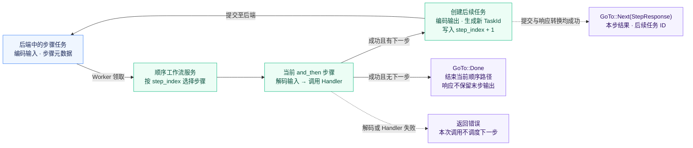
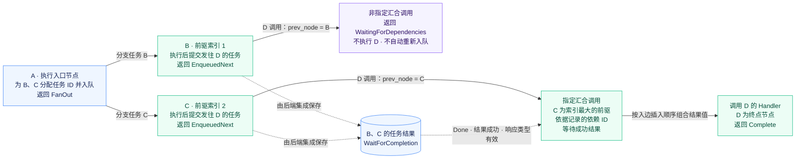

<p align="center">
  
</p>

<h1 align="center">miju-workflow</h1>

<p align="center">
  <a href="https://github.com/nanfeng-labs/miju/blob/main/miju-workflow/README.md">English</a>
</p>

为 miju worker 构建类型化任务序列和依赖图。

- **[顺序工作流](#顺序工作流)：** 普通的非终止步骤会编码输出，并将下一步骤的任务加入队列；集合步骤负责筛选、映射元素，或将元素归约到累加器。
- **[图工作流](#图工作流)：** 图服务执行节点、将后续任务入队，并在分支汇合时收集已存储的结果。

## 顺序工作流

### 顺序执行

下图展示步骤索引有效时，普通 `and_then` 步骤的调度与结果返回。延迟、集合处理和重复步骤的专用转移不在此图范围内。



每次成功推进都会生成新的任务 ID，将步骤索引递增，并把编码后的输出作为下一任务的输入。`StepResponse` 描述当前调用及其创建的后续任务，不表示后续步骤已经完成。提交新任务后，当前响应的转换仍可能失败；重试可能再次提交任务。

此示例在内存中运行，并等待入口任务的已存储结果：

```rust
use miju_core::{
    backend::{TaskSink, WaitForCompletion},
    task::{builder::TaskBuilder, task_id::{GenerateId, RandomId}},
    error::BoxDynError,
    worker::{builder::WorkerBuilder, context::WorkerContext},
};
use futures_util::StreamExt;
use miju_workflow::{SteppedFlow, in_memory::InMemoryWorkflow, sequential::{GoTo, StepResponse}};

#[tokio::main(flavor = "current_thread")]
async fn main() -> Result<(), BoxDynError> {
    let mut backend = InMemoryWorkflow::create();
    let mut observer = backend.clone();
    let entry_id = RandomId::generate();
    backend.push_task(TaskBuilder::new(12u32).task_id(entry_id.clone()).build()).await?;
    let flow = SteppedFlow::new("format-count")
        .and_then(async |count: u32| count + 1)
        .and_then(async |count: u32| format!("count={count}"))
        .and_then(async |message: String, worker: WorkerContext| {
            assert_eq!(message, "count=13");
            worker.stop().unwrap();
        });
    let worker = WorkerBuilder::new("format-worker").backend(backend).build(flow);
    tokio::time::timeout(std::time::Duration::from_secs(5), worker.run()).await??;
    let mut results = WaitForCompletion::<GoTo<StepResponse>>::wait_for(&mut observer, [entry_id]);
    let result = tokio::time::timeout(std::time::Duration::from_secs(5), results.next())
        .await?.expect("entry result")?;
    assert!(matches!(result.result, Ok(GoTo::Next(_))));
    Ok(())
}
```

处理器使用与普通 core 任务相同的参数提取机制。步骤可读取 `Data<StepContext<B>>` 获取自身位置和后端。每个后续任务都有新的任务 ID 和步骤元数据；前一任务的任意元数据和应用数据不会自动复制。

### 步骤上下文

`WorkflowContext` 在任务元数据中存储步骤索引；`StepContext<B>` 携带后端、当前步骤索引，以及是否存在后续步骤的信息。

使用 core 的 `Metadata` trait 写入和读取工作流进度：

```rust
use miju_core::task::metadata::{Metadata, MetadataStore};
use miju_workflow::sequential::WorkflowContext;

let mut metadata = MetadataStore::new();
WorkflowContext { step_index: 2 }.inject(&mut metadata)?;
let restored = WorkflowContext::extract(&metadata)?;
assert_eq!(restored.step_index, 2);
# Ok::<(), miju_workflow::sequential::context::WorkflowContextError>(())
```

元数据键为 `miju_workflow.context.step_index`。键缺失、无效的无符号整数值和重复写入都会返回 `WorkflowContextError`。默认上下文从索引零开始，但从空元数据提取上下文会返回错误。这两种上下文都不会检查索引是否指向已有步骤。

克隆 `StepContext` 会克隆其后端；共享行为取决于该后端的 `Clone` 实现。上下文类型只承载状态；`SteppedFlow` 构建执行管线，其工作流服务负责将任务分派到相应步骤。

### 延迟步骤

使用 `delay_for` 指定固定时长，或使用 `delay_with` 根据解码后的任务计算时长。两者都会添加独立步骤，将原始载荷以新的任务 ID、下一步骤索引和 `run_at` 时间戳重新入队：

```rust
use std::time::Duration;
use miju_core::{backend::ext::shared::Shared, task::Task};
use miju_workflow::{SteppedFlow, in_memory::InMemoryWorkflow};

let flow = SteppedFlow::<u32, u32, Shared<InMemoryWorkflow<u32>>>::new("scheduled")
    .delay_for(Duration::from_secs(30))
    .delay_with(|task: Task<u32>| Duration::from_secs(u64::from(task.args)))
    .and_then(async |value: u32| value.to_string());
```

这段代码只构建工作流；执行仍需要 worker 和后端。延迟步骤本身不会休眠。后端必须执行调度时间戳约束，时间戳使用整数 Unix 秒。内存后端目前会立即交付这些任务。延迟结果包含时长和下一任务 ID。

位于末尾的固定延迟或计算延迟返回 `GoTo::Done`，不调度后续任务。计算延迟仍会在结束前解码输入并调用时长函数。

### 筛选与映射集合

对可迭代对象使用 `filter_map`，为每个元素运行处理器。返回 `Some(value)` 保留映射后的值；返回 `None` 丢弃该元素。工作流将元素任务和收集器入队，收集器等待结果，再将非空的 `Vec<Output>` 传递给下一步骤。这要求后端记录结果并实现 `WaitForCompletion`，例如 `InMemoryWorkflow`：

```rust
use miju_core::{
    backend::TaskSink,
    worker::{builder::WorkerBuilder, context::WorkerContext},
};
use miju_workflow::{SteppedFlow, in_memory::InMemoryWorkflow};

# #[tokio::main]
# async fn main() {
let backend = InMemoryWorkflow::create();
let mut producer = backend.clone();
producer.push(vec![1u32, 2, 3, 4]).await.unwrap();

let flow = SteppedFlow::new("even-labels")
    .filter_map(async |n: u32| (n % 2 == 0).then(|| format!("item-{n}")))
    .and_then(async |mut labels: Vec<String>, worker: WorkerContext| {
        labels.sort();
        assert_eq!(labels, ["item-2", "item-4"]);
        worker.stop().unwrap();
    });
let worker = WorkerBuilder::new("even-labels").backend(backend).build(flow);
# tokio::time::timeout(std::time::Duration::from_secs(5), async {
worker.run().await.unwrap();
# }).await.unwrap();
# }
```

输出顺序遵循后端结果流，不一定与输入顺序相同。空输入和全部被过滤的集合目前会在收集器处以 `GoTo::Break([])` 停止，后续步骤不会运行。入口任务在入队后返回 `GoTo::Done`，因此仅等待其 ID 无法观察集合处理完成。分发不具备事务性：入队失败可能留下已创建但没有收集器的元素任务。无效元素载荷会返回解码错误。结果流错误、子任务结果错误和格式错误的收集值都会传播；非 `GoTo::Break` 的收集结果会被跳过。

### 归约集合

使用 `fold` 将可迭代对象归约为一个值。处理器接收 `(accumulator, item)`，并返回相同类型的累加器。初始值来自 `Default`；每个元素按迭代器顺序由独立的队列任务处理。当 `fold` 是第一个步骤时，构建 worker 目前需要在 `WorkflowService` 中显式指定集合类型。累加器类型可以与元素类型不同：

```rust
use miju_core::{
    backend::TaskSink,
    worker::{builder::WorkerBuilder, context::WorkerContext},
};
use miju_workflow::{
    SteppedFlow, in_memory::InMemoryWorkflow, sequential::service::WorkflowService,
};

# #[tokio::main]
# async fn main() {
let backend = InMemoryWorkflow::create();
let mut producer = backend.clone();
producer.push(vec![2u32, 4, 6]).await.unwrap();

let flow = SteppedFlow::new("sum")
    .fold(async |(sum, value): (u64, u32)| sum + u64::from(value))
    .and_then(async |total: u64, worker: WorkerContext| {
        assert_eq!(total, 12);
        worker.stop().unwrap();
    });
let worker = WorkerBuilder::new("sum")
    .backend(backend)
    .build::<_, WorkflowService<_, Vec<u32>, Vec<u32>>, _>(flow);
# tokio::time::timeout(std::time::Duration::from_secs(5), async {
worker.run().await.unwrap();
# }).await.unwrap();
# }
```

初始化任务和中间任务返回携带后续任务 ID 的 `GoTo::Next`。最后一个元素返回包含最终值的 `GoTo::Break`。如果还有后续工作流步骤，该步骤已经入队，其 ID 包含在这个 `Break` 响应中；仅凭该变体不能判断执行已经停止。末尾的 fold 保留最终值，且没有下一任务 ID。

Fold 需要 codec 和任务提交接口，但不要求 `WaitForCompletion`。每个后续任务都会序列化累加器和所有剩余元素，因此大型集合会产生重复复制与编码开销。空集合使用已有累加器完成，不调用处理器；新的 fold 使用默认值。组合在 `filter_map` 之后时，全部被过滤的结果会在到达 fold 前停止。缺失或无法识别的 fold 状态元数据会触发初始化。

### 重复执行直到结果就绪

当步骤需要使用相同输入重复运行，直到处理器返回 `Some(output)` 时，可使用 `repeat_until`。返回 `None` 会在同一步骤创建新任务，并保留原始编码参数。读取 `Meta<RepeaterState>` 可查看此前的重复次数和上一任务 ID：

```rust
use miju_core::{
    backend::TaskSink,
    task::metadata::Meta,
    worker::{builder::WorkerBuilder, context::WorkerContext},
};
use miju_workflow::{
    SteppedFlow, in_memory::InMemoryWorkflow, sequential::repeat_until::RepeaterState,
};

# #[tokio::main]
# async fn main() {
let backend = InMemoryWorkflow::create();
let mut producer = backend.clone();
producer.push(7u32).await.unwrap();

let flow = SteppedFlow::new("repeat")
    .repeat_until(async |value: u32, Meta(state): Meta<RepeaterState>| {
        (state.iterations() >= 2).then_some(value)
    })
    .and_then(async |value: u32, worker: WorkerContext| {
        assert_eq!(value, 7);
        worker.stop().unwrap();
    });
let worker = WorkerBuilder::new("repeat").backend(backend).build(flow);
# tokio::time::timeout(std::time::Duration::from_secs(5), async {
worker.run().await.unwrap();
# }).await.unwrap();
# }
```

示例会调用处理器三次，迭代计数分别为零、一和二。没有内置延迟或最大次数；由处理器决定何时退出。`None` 保留原始载荷，对解码后输入的修改不会传入下一任务。任意任务元数据和应用数据不会自动复制到新任务。

重复任务返回 `GoTo::Break`，其中结果为空值，并包含下一轮迭代的 ID。有后续步骤时，`Some(output)` 返回 `GoTo::Next`；否则返回保留输出的终止 `GoTo::Break`。检查 `next_task_id` 可区分继续迭代与完成。当前注册约束要求：连接类型化的下一步骤时，输入和输出类型必须一致；末尾的 repeater 可以改变类型。缺失重复元数据时使用初始状态。格式错误的元数据也会重置服务状态，但请求 `Meta<RepeaterState>` 的处理器会收到提取错误。

## 图工作流

### 构建依赖图

`GraphFlow` 注册任务函数或 Tower 服务，并将其输出连接到依赖节点的输入。`add_task` 使用函数的 Rust 类型名作为标签；`add_node` 接受显式名称。`depends_on` 添加入边，并返回提供节点索引与边索引的句柄：

```rust
use miju_core::task::task_fn::task_fn;
use miju_workflow::{GraphFlow, in_memory::InMemoryWorkflow};

let graph = GraphFlow::<InMemoryWorkflow<u32>>::new("counts");
let first = graph.add_node("first", task_fn(|value: u32| async move { value + 1 }));
let second = graph.add_node("second", task_fn(|value: u32| async move { value + 2 }));
let total = graph.add_task(|(left, right): (u32, u32)| async move { left + right })
    .depends_on((&first, &second));
let values = graph.add_task(|values: Vec<u32>| async move { values.len() })
    .depends_on(vec![&first, &second]);

graph.validate()?;
assert_eq!(total.edges().len(), 2);
assert_eq!(values.edges().len(), 2);
assert!(graph.to_dot().contains("first"));
# Ok::<(), miju_workflow::graph::error::GraphFlowError>(())
```

依赖节点的输出类型必须匹配接收节点的输入类型。单个 builder 和句柄提供一个输出，借用元组最多支持八个输出，向量提供同类型集合。向量依赖目前至少需要两个元素；更短的向量会 panic。自定义 `DepsCheck` 实现可以直接提供索引。

连接节点不会执行处理器，也不会检查环。`validate` 检测有向环（包括自环），同时接受空图和不相连的无环组件。它不检查图归属、名称或传输格式兼容性。`new_typed` 目前与 `new` 行为相同。`route` 注册的函数具有额外的输出到节点索引转换约束，但执行仍遵循普通出边，不使用该转换选择路径。

Builder 和句柄必须指向同一张图。它们的索引不保留图身份：来自其他图但未越界的索引可能连接到非预期节点；越界索引会 panic，并可能使图锁中毒。重复依赖创建平行边。克隆的 builder 向同一节点追加内容，而每个返回句柄仅列出自身 `depends_on` 调用添加的边。

DOT 导出直接插入标签，不进行转义。重复名称会保留所有节点，但仅为最新节点设置标签。依赖 DOT 输出时，请使用不含引号、反斜杠或换行的不同名称。名称重复时，`RootGraphService::get_node_by_name_mut` 也会选择最近注册的节点。

### 图执行

下图展示简单菱形依赖 `A → B、C → D` 的成功路径，假定图上下文和依赖任务 ID 完整，且后端集成保存节点执行结果。B、C 的节点索引分别为 1、2。



A 为两个分支入队后返回 `FanOut`；B、C 各自向 D 提交后续任务，并返回 `EnqueuedNext`。来自索引最大前驱 C 的 D 调用负责等待依赖结果，与分支完成先后无关；来自 B 的调用返回 `WaitingForDependencies`，不执行 D，也不自动重新入队。

指定汇合调用要求依赖结果为 `Done`、结果为 `Ok` 且响应类型有效，再按入边插入顺序组合输入。D 的 `Complete` 表示该终点节点完成，不是整个工作流的完成保证。

将 `GraphFlow` 传给 `WorkerBuilder::build`，会通过 `IntoWorkerService` 将其转换为 `graph::RootGraphService`。转换会验证环，验证失败时 panic；可先调用 `graph.validate()` 处理错误。图服务直接接收紧凑表示任务。内存 worker 使用 `InMemoryWorkflow<Vec<u8>>`；`WorkflowSink::push_start` 负责编码入口输入：

```rust
use miju_core::worker::{builder::WorkerBuilder, context::WorkerContext};
use miju_workflow::{GraphFlow, WorkflowSink, in_memory::InMemoryWorkflow};

# #[tokio::main]
# async fn main() {
let backend = InMemoryWorkflow::<Vec<u8>>::create();
let mut producer = backend.clone();
let graph = GraphFlow::new("counts");
let first = graph.add_task(|value: u32| async move { value + 1 });
let _last = graph
    .add_task(|value: u32, worker: WorkerContext| async move {
        assert_eq!(value, 8);
        worker.stop().unwrap();
        value * 2
    })
    .depends_on(&first);
graph.validate().unwrap();

producer.push_start(7_u32).await.unwrap();
let worker = WorkerBuilder::new("counts").backend(backend).build(graph);
# tokio::time::timeout(std::time::Duration::from_secs(5), async {
worker.run().await.unwrap();
# }).await.unwrap();
# }
```

Worker 后端配置的参数类型必须匹配其紧凑任务类型。对已编码字节向量使用 `TaskSink::push` 会再次编码这些字节。也可通过 `IntoWorkerService::into_service(backend).service` 直接调用服务。

有多个入口节点时，初始参数是经过 codec 编码的 `Vec<B::Compact>`，按节点索引升序为每个入口分别编码输入。对 JSON 而言，它是字节数组的列表，不是处理器值组成的普通 JSON 元组。`WorkflowSink::start_fan_out` 接受具有二至十二个元素的元组或向量，并准备该布局。输入数量必须等于入口数量。空图接受编码后的空列表，并返回不含任务的 `EntryFanOut`。

每次节点调用报告一种调度结果：

| 响应 | 含义 |
| --- | --- |
| `EntryFanOut` | 初始输入已为入口节点入队。 |
| `FanOut` | 多个后续节点已入队；包含当前节点的结果及后续任务 ID。 |
| `EnqueuedNext` | 一个后续节点已入队；包含当前节点的结果。 |
| `WaitingForDependencies` | 本次调用没有执行汇合节点，也没有将自身重新入队。 |
| `Complete` | 终止节点已完成；包含其结果。 |

这些响应不证明整张图已经完成。特别是，等待根任务的结果不会等待所有分支。在汇合处，节点索引最大的前驱等待所有已记录依赖 ID 的结果；其他前驱返回 `WaitingForDependencies`。成功依赖结果必须具有 `Done` 状态，并包含 `FanOut`、`EnqueuedNext` 或 `Complete`；其值按入边插入顺序提供。后端必须存储这些响应，并实现 `WaitForCompletion<GraphNodeResponse>`。

不含图上下文字段的任务从唯一入口节点开始，与节点注册顺序无关。如果存在任何图上下文字段，提取错误会直接返回，不会启动新的入口任务。节点索引必须能放入 `u32`；进度位置仍为 `usize`。初始任务应使用新的元数据。

根服务每次调用都会克隆节点服务，并在调用所选节点前等待其就绪。克隆实例中的局部可变状态不会跨调用保留。新任务复制图元数据，但省略任意应用数据和无关元数据。分发为新入队节点记录新 ID，并保留其他映射。进入汇合节点的每个后续任务会在可用时记录当前前驱任务的 ID。其他后续任务沿用既有映射行为，独立扩展的分支不会合并映射。分发会将位置增加两次，而已完成节点集合不会更新。不要将这些字段视为完整执行历史，也不要假定较长分支之间的汇合已获得完整支持。

依赖等待没有超时。映射缺失可能返回等待响应，而不调度下一次尝试；后端错误只在结果流结束后统一收集。多个后续任务入队发生部分失败时没有回滚，重试可能重复处理器副作用或将重复任务入队。目前尚不支持嵌套工作流组合。

### 图数据类型

`graph` 模块提供进度元数据、响应记录和错误类型。`GraphFlowContext` 跟踪当前节点、前驱节点、已完成节点、依赖任务 ID、拓扑位置和根任务 ID。它可以存入任务元数据，也可以使用 Serde 序列化：

```rust
use miju_core::task::{metadata::{Metadata, MetadataStore}, task_id::TaskId};
use miju_workflow::graph::GraphFlowContext;
use petgraph::graph::NodeIndex;

let mut context = GraphFlowContext::new(Some(TaskId::from_string("root")));
context.current_node = NodeIndex::new(2);
context.current_position = 1;
context.prev_node = Some(NodeIndex::new(0));
context.completed_nodes.insert(NodeIndex::new(0));
context.node_task_ids.insert(NodeIndex::new(0), TaskId::from_string("entry"));
context.is_initial = false;

let mut metadata = MetadataStore::new();
context.inject(&mut metadata)?;
let restored = GraphFlowContext::extract(&metadata)?;
let dependencies = restored.get_dependency_task_ids(&[NodeIndex::new(0), NodeIndex::new(1)]);
assert_eq!(restored.current_node, NodeIndex::new(2));
assert_eq!(dependencies.len(), 1);
# Ok::<(), miju_workflow::graph::context::GraphFlowContextError>(())
```

元数据键使用 `miju_workflow.graph.` 前缀。提取需要 `current_node` 和 `current_position`；缺失的可选字段使用空值或默认值。依赖查询会省略没有记录任务 ID 的节点，不检查完成情况。`new` 从节点零开始，并设置 `is_initial = true`；派生的 `Default` 则将该标志设为 false。两者都不验证节点索引，也不选择图的实际入口节点。

缺失或格式错误的 `is_initial` 元数据会被视为 true。注入可能在返回错误前完成部分写入，而重复的 `is_initial` 键目前会 panic。请向新的元数据存储注入。节点与任务映射使用逗号分隔且不转义，因此包含逗号的任务 ID 无法可靠往返转换。

`graph::response::GraphNodeResponse` 表示入口分发、节点分发、下一步骤入队、依赖等待和完成。其值携带 JSON 结果以及节点与任务映射。`graph::error` 提供 `GraphFlowError` 和 `GraphServiceError`，包括包装的底层错误。`RootGraphService` 使用这些记录报告节点执行与后续任务调度。

### 图节点适配器

`graph::node::GraphNodeService` 包裹类型化 Tower 服务。它接受包含后端紧凑值的 `graph::NodeInput::Single`，或包含有序 JSON 依赖结果的 `NodeInput::FanIn`。任务必须在运行时数据中携带后端 codec。例如，独立适配器可以将两个依赖结果相加，同时返回编码字节和 JSON：

```rust
use miju_codec::json::JsonCodec;
use miju_core::task::{builder::TaskBuilder, task_fn::task_fn};
use miju_workflow::{
    graph::{NodeInput, node::GraphNodeService},
    in_memory::InMemoryWorkflow,
};
use serde_json::json;
use tower::ServiceExt;

# #[tokio::main]
# async fn main() -> Result<(), miju_core::error::BoxDynError> {
let handler = task_fn(|(left, right): (u32, u32)| async move { left + right });
let node = GraphNodeService::<_, InMemoryWorkflow<u32>, (u32, u32)>::new(handler);
let task = TaskBuilder::new(NodeInput::FanIn(vec![json!(4), json!(5)]))
    .data(JsonCodec::<Vec<u8>>::default())
    .build();
let (compact, value) = node.oneshot(task).await?;
assert_eq!(compact, b"9");
assert_eq!(value, json!(9));
# Ok(())
# }
```

适配器委托就绪检查，并保留任务的执行上下文。输入解码错误会跳过处理器。处理器错误、输出编码错误和 JSON 序列化错误都会返回；序列化失败时不会回滚处理器副作用。缺少 codec 数据会在返回 Future 前 panic，汇合输入也不例外。

单个输入使用 `graph::decode::GraphCodec`。标量、Option 和 Result 通过后端 codec 处理。具有二至十二个元素的元组使用分别编码元素的列表；解码后长度错误返回 `GraphFlowError::InputCountMismatch`，codec 错误包装为 `GraphFlowError::Codec` 并保留原始错误来源。向量和单元素元组的编码与解码不对称，例如字节 JSON 无法通过此 trait 对非空 `Vec<u32>` 或 `(u32,)` 完成往返转换。节点输出使用普通 codec 编码，可能与图元组布局不同。

汇合输入绕过 `GraphCodec::decode`：其 JSON 值作为数组反序列化为处理器输入。这会保留提供的顺序，但不会获取结果、检查就绪状态或推断每个位置应属于哪个依赖。`RootGraphService` 在调用适配器前执行依赖查询。

## 后端与任务提交

### 内存结果

`InMemoryWorkflow::create()` 返回可克隆的 `Shared` 句柄。参数编码为 JSON 字节；结果存储层记录每个已执行任务。公开的 `ResultStore`、`StoreResultsLayer` 和 `StoreResultsService` 类型也允许直接检查或组合该中间件。直接传给该层的任务必须已经具有 ID。

`wait_for` 产出所请求 ID 的结果，并在每个唯一请求 ID 都被观察到后结束。重复 ID 对每个任务只产出一个结果。等待入口任务不会等待所有后续步骤；可检查 `StepResponse.next_task_id` 获取后续任务，包括 fold 最后的 `GoTo::Break` 和 repeater 在迭代之间的 `GoTo::Break`。`check_status` 只返回当前已存储的结果，省略缺失的 ID。

处理器错误和输出序列化错误以流错误返回；如果请求的已存储任务失败，`check_status` 会失败。成功值无法解码为请求的输出类型时，则在 `TaskResult.result` 中产生错误。

结果仅保存在进程内，没有容量上限，读取后仍然保留。不提供持久化或自动淘汰。等待流各自拥有独立的注册记录，并在被丢弃时移除这些记录。向已关闭通道发送失败后，再次使用内存 sink 也可能 panic，因为底层错误映射器会在第一次失败时被消耗。

后端交付队列任务时不执行调度时间戳约束。临时文件集成可使用 `miju-file-storage::JsonStorage`，顺序执行集成测试也覆盖了它。

### 将工作流任务入队

导入 `WorkflowSink`，通过兼容后端编码并发送入口、步骤或节点输入。每次调用都会生成 ID 并将一个任务入队：

| 方法 | 编码 | 工作流元数据 |
| --- | --- | --- |
| `push_start(args)` | 普通后端 codec | 无；通过服务的入口路径开始执行。 |
| `start_fan_out(args)` | `GraphCodec` | 无；执行器分发多个入口输入。 |
| `push_step(args, index)` | 普通后端 codec | 指定的顺序步骤索引。 |
| `push_node(args, index)` | 普通后端 codec | 以生成的任务 ID 为根的新图上下文。 |

输入可以不同于后端配置的参数类型，从而支持后续步骤接收不同类型。这些辅助方法不会检查工作流，也不会验证索引、输入类型或入口数量。`push_node` 将前驱节点和依赖 ID 留空，不能恢复汇合节点或已有执行进度。`start_fan_out` 根据输入类型而非图拓扑进行编码。可运行的多入口示例见 [sink 模块](sink)。

使用字节形式的 JSON 时，具有两个或更多字段的单个元组节点需要 `start_fan_out` 提供的图元组布局。单个向量节点则要求 `push_start` 的普通 codec 编码；图向量编码用于分别编码的入口输入。现有 `GraphCodec` 的单元素及集合限制仍然适用。

编码失败会在发送前返回 `TaskSinkError::CodecError`；后端发送失败返回 `TaskSinkError::PushError`。成功表示 sink 的发送操作完成，不代表处理器已经运行。取消和部分发送行为取决于后端。这些辅助方法不返回任务 ID，也不能携带调用方提供的元数据、调度选项或应用数据；需要这些信息时，请使用任务 builder 和紧凑表示后端 sink。

## Feature

默认 `tracing` feature 启用图执行、结果存储和 core worker 诊断。禁用默认 feature 可省略这些事件。两种配置都保留共享后端句柄和 JSON 编码。

## 执行限制

后端必须提供紧凑任务交付、codec、sink、配置和可克隆句柄。后端的持久化、调度和唤醒限制仍然适用；内存后端和文件集成都不提供崩溃恢复或恰好一次执行保证。

在顺序工作流中，普通处理器错误和解码错误由服务返回，不调度下一步骤。最后一个普通步骤返回 `GoTo::Done`，其输出不会保留在该响应中。缺失或格式错误的工作流元数据目前会分派到步骤零。未知索引或空工作流会返回 `AbortError`；Worker 将任务标记为 `Killed`，内置重试策略不会重试该任务。服务还存在既有的就绪性限制，因此自定义步骤不应假定每个内部服务在首次调用前都已接受就绪轮询。

底层 `GoTo::DelayFor` 转移也会附带调度元数据；实际延迟执行取决于后端。图特有的执行限制见上文。
