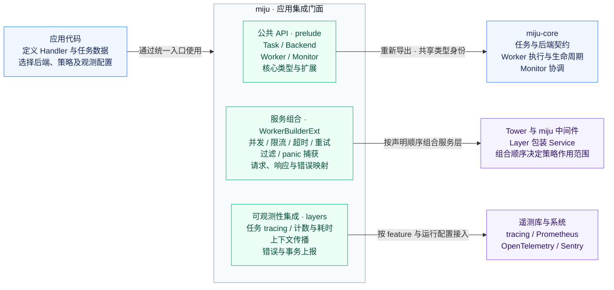

<p align="center">
  
</p>

<h1 align="center">miju</h1>

<br />

<div align="center">
  <a href="README.md">English</a>
</div>

<br />

miju 是后台任务处理的应用入口，将任务、后端、Worker 和 Monitor API 汇集到
一个 [`prelude`] 中，并为 [`WorkerBuilder`](prelude::WorkerBuilder) 扩展中间件组合方法。
底层类型与 `miju-core` 共享，因此应用与后端集成可以直接交换任务，无需转换。

## 应用集成门面



图中箭头表示 API 依赖与组合关系，不表示任务执行顺序。
执行策略与可观测性按职责分列，两者都通过服务层集成。

**共享核心类型。** prelude 重新导出选定的核心 API，保留与 `miju-core` 相同的类型身份。
应用与后端集成可以直接交换任务，无需转换。具体支持哪些查询与管理操作，
仍取决于所选后端实现的能力接口。

**有序的服务组合。** `WorkerBuilderExt` 为核心 `WorkerBuilder` 添加中间件，以及请求、响应和错误转换。
先添加的层包裹后添加的层：请求按添加顺序进入，响应与错误反向返回。
因此，组合顺序决定重试、超时和观测的作用范围。
panic 捕获适用于栈展开 panic，具体边界见 [Panic 处理](#panic-处理)。

**显式配置集成。** feature 使对应 API 可用；应用仍需挂载中间件，
并配置 subscriber、recorder、provider 或客户端。
OpenTelemetry 追踪上下文传播还需要启用 `tracing`，并完成 [OpenTelemetry](#opentelemetry) 一节中的配置。
可选的 `config` feature 提供 Worker 与中间件的[配置驱动构建入口](#worker-配置)。

## 快速开始

将 `miju` 和异步运行时加入应用。此示例使用 Tokio：

```toml
[dependencies]
miju = "0.1.1"
tokio = { version = "1", features = ["macros", "rt", "time"] }
```

将类型化任务入队，附加应用数据并运行 Worker。处理器在处理完任务后停止 Worker，使示例能够退出。

```rust
use miju::prelude::*;
use std::{
    sync::{Arc, atomic::{AtomicUsize, Ordering}},
    time::Duration,
};

async fn count(
    amount: usize,
    total: Data<Arc<AtomicUsize>>,
    worker: WorkerContext,
) -> Result<(), BoxDynError> {
    total.fetch_add(amount, Ordering::SeqCst);
    worker.stop()?;
    Ok(())
}

#[tokio::main(flavor = "current_thread")]
async fn main() -> Result<(), BoxDynError> {
    let mut storage = MemoryStorage::new();
    storage.push(7usize).await?;
    let total = Arc::new(AtomicUsize::new(0));

    let worker = WorkerBuilder::new("counter")
        .backend(storage)
        .data(total.clone())
        .map_request(|mut task: Task<usize>| {
            task.args *= 2;
            task
        })
        .build(count);

    tokio::time::timeout(Duration::from_secs(5), worker.run()).await??;
    assert_eq!(total.load(Ordering::SeqCst), 14);
    Ok(())
}
```

[`MemoryStorage`](prelude::MemoryStorage) 是进程内队列，不会持久化任务。
请按应用所需的能力选择后端。后端 trait 描述这些能力；导入 trait 并不意味着所有后端都实现了它。

## 选择 feature

默认启用 `tracing`、`catch-panic`、`limit`、`timeout`、`retry`、`config` 和 core 的默认 feature。
这些 feature 提供中间件 API；每个 Worker 通过 builder 或配置应用中间件。
tracing subscriber 和其他遥测客户端由应用安装。

默认构建要求 Rust 1.85。`sentry` 和 `full` 会启用 UUID 任务 ID 转换，因此要求 Rust 1.89。

| 选择 | 启用的能力 |
| --- | --- |
| 默认 | core 默认 feature、tracing、panic 捕获、限制、超时、重试和 Worker 配置 |
| `default-features = false` | 核心类型、Worker 执行，以及不受 feature 限制的 builder 组合方法 |
| `full` | 默认 feature、Sentry、Prometheus、OpenTelemetry、过滤和任务跟踪 |
| `shared` | 可克隆的后端句柄；使用 `full` 时仍需单独启用 |
| `docsrs` | 生成 feature 文档；使用 `full` 时仍需单独启用 |

如需精简配置，仅选择应用使用的 feature：

```toml
miju = { version = "0.1.1", default-features = false, features = ["timeout"] }
```

`full` 不会启用 `shared` 或 `docsrs`；Cargo 的 `--all-features` 会同时启用它们。
核心序列化能力通过 `miju-core/serde` 提供。

## 任务处理

- [`Task`](prelude::Task) 保存载荷和执行上下文。
  [`TaskBuilder`](prelude::TaskBuilder) 在任务经 [`TaskSink`](prelude::TaskSink) 提交前设置队列与执行元数据。
- [`WorkerBuilder`](prelude::WorkerBuilder) 将后端与异步处理器连接起来。
  [`Data`](prelude::Data) 让处理器除了参数和 [`WorkerContext`](prelude::WorkerContext) 之外，还能访问应用状态。
- [`WorkerBuilderExt`](layers::WorkerBuilderExt) 提供可选层、函数层，以及对请求、响应、错误和 Future 的转换。
  先添加的层包裹后添加的层：请求按添加顺序经过各层，结果则按相反顺序返回。
- [`Monitor`](prelude::Monitor) 协调多个 Worker 及其关闭。
  [`EventListenerExt`](prelude::EventListenerExt) 观察 Worker 生命周期和处理事件。

应用代码可使用 `miju::prelude::*`。也可以从 [`task`]、[`backend`] 和 [`error`] 模块显式导入。
实现后端或 Worker 内部功能的库可以直接依赖 `miju-core`。

## 执行控制

默认 feature 包含限制和超时。Worker 需要谓词过滤时，启用 `filter`：

| Feature | Builder 方法 | 用途 |
| --- | --- | --- |
| `limit` | `concurrency`、`rate_limit` | 限制执行中的调用数和每个时间段内的调用数 |
| `timeout` | `timeout` | 调用超过时间限制时返回错误 |
| `filter` | `filter`、`filter_async` | 在处理器运行前接受、修改或拒绝任务 |

例如，在默认 feature 基础上添加过滤：

```toml
miju = { version = "0.1.1", features = ["filter"] }
```

以下 Worker 最多允许四个执行中的调用，每秒最多启动十次调用，并拒绝参数为零的任务。
超时层先于过滤器和处理器添加，因此包裹它们两者。

```rust
# #[cfg(all(feature = "limit", feature = "timeout", feature = "filter"))]
# {
use miju::prelude::*;
use std::time::Duration;

#[tokio::main(flavor = "current_thread")]
async fn main() -> Result<(), BoxDynError> {
    let mut storage = MemoryStorage::new();
    storage.push(7usize).await?;

    let worker = WorkerBuilder::new("controlled")
        .backend(storage)
        .concurrency(4)
        .rate_limit(10, Duration::from_secs(1))
        .timeout(Duration::from_secs(1))
        .filter(|task: Task<usize>| {
            if task.args == 0 {
                Err::<_, BoxDynError>("amount must be nonzero".into())
            } else {
                Ok(task)
            }
        })
        .build(|amount: usize, worker: WorkerContext| async move {
            assert_eq!(amount, 7);
            worker.stop().unwrap();
        });

    tokio::time::timeout(Duration::from_secs(5), worker.run()).await??;
    Ok(())
}
# main().unwrap();
# }
```

`rate_limit` 和 `timeout` 使用 Tokio 定时器，需要启用 Tokio 的时间驱动。
谓词拒绝任务时直接返回错误，不调用处理器。
超时到期会丢弃内层 Future，但无法抢占阻塞代码，也无法停止处理器独立派生的工作。

需要显式组合层时，`layers::limit` 提供 `ConcurrencyLimitLayer`、`GlobalConcurrencyLimitLayer` 和 `RateLimitLayer`；
`layers::TimeoutLayer` 提供超时层。`GlobalConcurrencyLimitLayer` 的克隆在多个 Worker 之间共享并发额度。

## 重试

默认 feature 包含 `retry`，提供 `.retry(policy)` 和 prelude 导出的重试策略。
`RetryPolicy::retries(n)` 允许首次执行后最多重试 `n` 次；`RetryPolicy::default()` 允许五次。
结果成功、任务已终止，或 Worker 已处于关闭中时，不会作出新的重试决定。

以下 Worker 使用默认中间件 API。并发限制覆盖任务的整个重试序列。
Tracing 包裹整个序列，超时与 panic 捕获则应用于每次尝试内部。
交换超时层与重试层的顺序，会让整个序列共享一个超时预算。

```rust
# #[cfg(all(feature = "retry", feature = "limit", feature = "tracing", feature = "timeout", feature = "catch-panic"))]
# {
use miju::prelude::*;
use std::time::Duration;

#[tokio::main(flavor = "current_thread")]
async fn main() -> Result<(), BoxDynError> {
    let mut storage = MemoryStorage::new();
    storage.push(7usize).await?;

    let worker = WorkerBuilder::new("retrying")
        .backend(storage)
        .concurrency(4)
        .enable_tracing()
        .retry(RetryPolicy::retries(2))
        .timeout(Duration::from_secs(1))
        .catch_panic()
        .on_event(|worker, event| match event {
            Event::Success(_) => worker.stop().unwrap(),
            Event::Error(error) => panic!("{error}"),
            _ => {}
        })
        .build(|value: usize, attempt: Attempt| async move {
            if attempt.current() < 3 {
                Err(std::io::Error::other("temporarily unavailable"))
            } else {
                Ok(value)
            }
        });

    tokio::time::timeout(Duration::from_secs(5), worker.run()).await??;
    Ok(())
}
# main().unwrap();
# }
```

使用 `.with_backoff(...)` 在重试之间等待，使用 `.retry_if(...)` 选择可重试的错误。
将 `.retry(...)` 放在需要重试其错误的层之前。`layers::retry` 模块重新导出 Tower 的重试与退避 API。

`RetryMetadataExt::retries` 将 `RetryConfig` 存入任务，通过 `.from_task_config()` 启用读取。
这个包装器将配置值与包含首次执行及执行前失败的总尝试次数比较，同时应用内层策略的限制。
执行前失败会消耗预算，但不会推进任务共享的尝试计数器。
元数据缺失或无效时，原样使用内层策略。

默认 panic 处理器返回 `AbortError`，两种重试策略都能识别它，包括装箱后的错误。
使用 `.retry_if(...)` 排除应当停止重试的自定义 panic 错误；panic 模块包含自定义处理器示例。
已有退避等待期间收到关闭请求，可能使重试继续等待就绪；
若关闭必须在期限内完成，应为 Worker 执行设置时间上限。

## Panic 处理

默认的 `catch-panic` feature 提供 `.catch_panic()`，将服务调用和 Future 轮询期间发生的栈展开 panic
转换为包含 `PanicError` 的 `AbortError`。成功响应和普通服务错误直接透传。
使用 `CatchPanicLayer::with_panic_handler` 自定义从 panic 载荷生成的错误。
`layers::catch_panic` 模块包含这两种形式的示例。

就绪检查、自定义 panic 处理器，以及独立派生任务中的 panic 不在此层的捕获范围内。
Rust 的 panic hook 仍会运行；使用 `panic = "abort"` 的构建无法通过此中间件恢复。

## 任务追踪

使用默认的 `tracing` feature 时，调用 `enable_tracing()`，将处理过程包裹在带有开始、成功和失败事件的 span 中。
在应用中配置 tracing subscriber，以收集这些事件和 core 生命周期日志。

```rust
# #[cfg(feature = "tracing")]
# #[tokio::main(flavor = "current_thread")]
# async fn main() -> Result<(), Box<dyn std::error::Error>> {
use miju::prelude::*;

let mut backend = MemoryStorage::new();
backend.push(7usize).await?;
let worker = WorkerBuilder::new("traced-worker")
    .backend(backend)
    .enable_tracing()
    .build(|value: usize, worker: WorkerContext| async move {
        tracing::info!(value, "processing task");
        worker.stop().unwrap();
        value * 2
    });
worker.run().await?;
# Ok(())
# }
# #[cfg(not(feature = "tracing"))]
# fn main() {}
```

使用 `layer(TraceLayer::new()...)` 自定义 span 工厂和回调。
默认事件为 DEBUG 级别的 `task.start`、`task.done`，以及 ERROR 级别的 `task.failed`。
完成事件记录耗时和结果；回调可选择其他字段或级别。
就绪错误，以及完成前被丢弃的未完成 Future，不会产生完成事件。
`layers::tracing` 模块说明了回调时机及层顺序如何影响重试报告。

`DefaultMakeSpan` 和 `ContextualTaskSpan` 在当前 span 下创建 span，记录任务 ID 和尝试次数。
两者都要求任务已分配 ID。`MakeSpan` 也接受固定 span 或闭包，以便自定义字段。

使用 `tracing::Instrument` 将生成的 span 附加到异步操作；模块中包含可运行示例。
`TracingContext` 重新导出 core 中用于存储显式追踪字段的元数据类型。
同时启用 `opentelemetry` 时，`ContextualTaskSpan` 可以恢复已存储的远程父上下文。
默认工厂仍使用当前活跃的 span。

## Prometheus 指标

启用 `prometheus`，并通过 Worker builder 的 `.layer(...)` 方法添加
`miju::layers::prometheus::PrometheusLayer::default()`，以记录已完成任务及其耗时。
该层产生 `tasks_total` 和 `task_duration_seconds`，标签包括 Worker 名称、Rust 参数类型（`queue`）和结果（`status`）。

应用负责安装指标 recorder 并暴露其输出。
`miju::layers::prometheus` 模块包含使用 `metrics-exporter-prometheus` 的可运行示例，涵盖直方图桶和 recorder 维护。
启用 `prometheus` feature 才能访问该模块。Exporter 的传输 feature 默认关闭，
因此启用此中间件不会启动 HTTP 监听器或推送网关。

## OpenTelemetry

启用 `opentelemetry`，并通过 `.layer(...)` 添加
`miju::layers::opentelemetry::OpenTelemetryMetricsLayer::default()`，以记录已完成任务数和处理耗时。
应在构建 Worker 前安装应用的全局 meter provider；该层在包裹服务时创建指标 instrument。
Exporter 及其 flush、shutdown 生命周期仍由应用管理。

分布式追踪还需要启用 `tracing`，配置带有 `tracing-opentelemetry` 的 tracing subscriber，
并安装兼容的 text-map propagator。在生产者端捕获 `OtelTraceContext::current()`，
转换为 `TracingContext`，通过 `TaskBuilder::metadata` 存储。
在消费者端使用 `TraceLayer::new().make_span_with(ContextualTaskSpan::new())`。
`OtelTraceContext` 文档包含可运行的传播示例。
仅启用 `opentelemetry` 不会启用 tracing 模块，也不会切换默认 span 工厂。

## Sentry

启用 `sentry`，并通过 `.layer(...)` 添加 `miju::layers::sentry::SentryLayer::new()`，
以报告任务错误和 transaction。此 feature 启用 UUID 任务 ID 转换，因此要求 Rust 1.89。
应用负责配置 Sentry SDK 客户端、传输、采样和关闭；仅启用 feature 不会启用客户端。

Transaction 在首次轮询时开始，在任务 Future 完成或已启动的 Future 被丢弃时结束。
丢弃已启动的 Future 会恢复原 hub 上先前的 span；未设置的 transaction 状态会变为 `Cancelled`，显式设置的状态则保持不变。
丢弃尚未轮询的 Future 不会启动 transaction。
该层使用当前 hub，因此应为每个任务提供独立 hub，以隔离 scope 变更。
取消和自定义 transaction 状态会影响报告。
`miju::layers::sentry` 模块说明了这些边界，以及直接使用 Tower 服务时的装箱错误要求。

## Worker 配置

默认的 `config` feature 提供 `WorkerFromConfig::try_config`，用于从 `WorkerConfig` 构建 Worker。
配置包含 Worker 名称、后端自己的配置，以及一组中间件描述。
解析与后端构建是分开的；应用加载配置时可以选择兼容 Serde 的格式。

```rust
# #[cfg(feature = "config")]
# fn main() -> Result<(), miju::error::BoxDynError> {
use miju::{config::{WorkerConfig, WorkerFromConfig}, prelude::*};
use std::collections::HashSet;

let config = WorkerConfig::<MemoryStorage<usize>> {
    name: "configured-worker".to_owned(),
    backend: (),
    middleware: HashSet::new(),
};
let _worker = WorkerBuilder::try_config(config)?
    .build(|value: usize| async move { value * 2 });
# Ok(())
# }
# #[cfg(not(feature = "config"))]
# fn main() {}
```

这会构建一个带有全新空内存队列的 Worker。中间件变体需要对应的 `timeout`、`limit`、`catch-panic` 或 `tracing` feature；
`config` 不会自动启用它们。`MiddlewareStack` 也可以装饰已有后端；
`config` 模块说明了其固定顺序、序列化字段和构建要求。

## 可选的 core 能力

`task-context` 通过 prelude 暴露 `TaskContext` 及其完成 Future。
`shared` 暴露 `Shared`，用于通过可克隆句柄共享后端。
