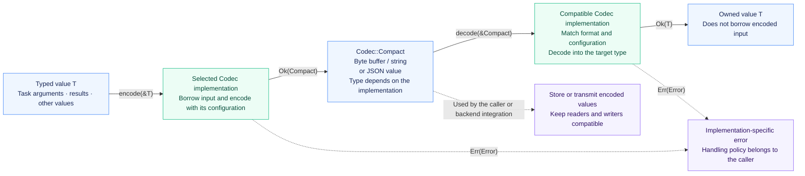

<p align="center">
  
</p>

<h1 align="center">miju-codec</h1>

<br />

<div align="center">
  <a href="README.zh-CN.md">简体中文</a>
</div>

<br />

Encoding and decoding strategies for task arguments, results, and other values
used by backends. Each codec implements
[`Codec`](miju_core::backend::codec::Codec) from `miju-core`; the trait is not
redefined or re-exported by this crate.

## Features

JSON is enabled by default. Disable default features to select only the formats
your application needs, or to build without any codec implementation.

| Feature | Codec | Compact representation | Required traits |
| --- | --- | --- | --- |
| `json` (default) | `json::JsonCodec` | `Vec<u8>`, `String`, or `serde_json::Value` | Serde `Serialize` and owned `Deserialize` |
| `msgpack` | `msgpack::MsgPackCodec` | `Vec<u8>` | Serde `Serialize` and owned `Deserialize` |
| `bincode` | `bincode::BincodeCodec` | `Vec<u8>` | Bincode `Encode` and `Decode<()>` |

All three formats support Rust 1.85. Enabling `json` or `msgpack` also enables
serialization support in `miju-core`. Bincode uses its native traits rather than
the Serde integration.

## Using a Codec

The diagram shows the representations and return values used by this crate's
codec implementations. Storage and transport remain integration responsibilities.



- **Borrowed inputs, owned outputs.** `encode(&T)` returns
  `Result<Compact, Error>`; `decode(&Compact)` returns `Result<T, Error>`.
  Neither operation consumes its input. The decoded value does not borrow the
  encoded input. JSON and MessagePack require
  `Serialize + for<'de> Deserialize<'de>`; Bincode uses `Encode + Decode<()>`.
- **Representation and format.** `Compact` is an associated type, not a promise
  of compression or smaller size. Two codecs using `Vec<u8>` are not necessarily
  compatible. Readers and writers must agree on format, configuration, and
  compatible types; the codec does not automatically detect the format.
- **Integration and errors.** Codecs convert values; they do not automatically
  store, send, or retry operations. Encoding and decoding errors are returned
  to the caller through the implementation's error type.

Import the shared trait to call `encode` and `decode`:

```rust
# #[cfg(feature = "json")]
# {
use miju_codec::json::JsonCodec;
use miju_core::backend::codec::Codec;

let codec = JsonCodec::<String>::default();
let arguments = vec!["report".to_owned(), "daily".to_owned()];
let encoded = codec.encode(&arguments)?;
let decoded: Vec<String> = codec.decode(&encoded)?;
assert_eq!(decoded, arguments);
# }
# Ok::<(), Box<dyn std::error::Error>>(())
```

The decoded type must own its data. The compact representation is selected by
the codec and must match what the backend stores. For JSON, choose
`JsonCodec::<Vec<u8>>`, `JsonCodec::<String>`, or
`JsonCodec::<serde_json::Value>` explicitly when type inference cannot determine
the output type.

## Formats and Errors

JSON uses `serde_json` and returns its error type directly. MessagePack uses
`rmp-serde`'s compact representation, which encodes structs as positional arrays.
Bincode uses version 2's standard configuration; decoding returns the first
value and discards the consumed-byte count, accepting trailing bytes. A successful
decode therefore does not verify that the entire input buffer was consumed.
Keep compatible types and encoding settings when exchanging or persisting binary data.

MessagePack and Bincode distinguish encoding and decoding failures through
their respective `MsgPackCodecError` and `BincodeCodecError` enums. Both enums
retain the underlying format error and are non-exhaustive.
