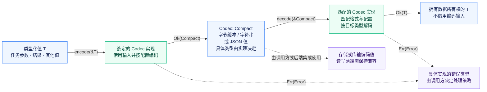

<p align="center">
  
</p>

<h1 align="center">miju-codec</h1>

<p align="center">
  <a href="https://github.com/nanfeng-labs/miju/blob/main/utils/miju-codec/README.md">English</a>
</p>

为后端使用的任务参数、结果及其他值提供编码与解码策略。

每种编解码器均实现 `miju-core` 中的
[`Codec`](miju_core::backend::codec::Codec)；本 crate 不重新定义或重新导出该 trait。

## 特性

默认启用 JSON。可以禁用默认 feature，仅选择应用需要的格式，
也可以在不启用任何编解码器实现的情况下构建。

| Feature | 编解码器 | 编码表示 |
| --- | --- | --- |
| `json`（默认） | `json::JsonCodec` | `Vec<u8>`、`String` 或 `serde_json::Value` |
| `msgpack` | `msgpack::MsgPackCodec` | `Vec<u8>` |
| `bincode` | `bincode::BincodeCodec` | `Vec<u8>` |

三种格式均支持 Rust 1.85。启用 `json` 或 `msgpack` 时，也会启用
`miju-core` 的序列化支持。Bincode 使用自身的原生 trait，不使用 Serde 集成。

## 使用编解码器

导入共享 trait 后即可调用 `encode` 和 `decode`：

```rust
# #[cfg(feature = "json")]
# {
use miju_codec::json::JsonCodec;
use miju_core::backend::codec::Codec;

let codec = JsonCodec::<String>::default();
let arguments = vec!["report".to_owned(), "daily".to_owned()];
let encoded = codec.encode(&arguments)?;
let decoded: Vec<String> = codec.decode(&encoded)?;
assert_eq!(decoded, arguments);
# }
# Ok::<(), Box<dyn std::error::Error>>(())
```

编码表示必须与后端存储的表示一致。使用 JSON 时，如果类型推导无法确定输出类型，应显式选择
`JsonCodec::<Vec<u8>>`、`JsonCodec::<String>` 或 `JsonCodec::<serde_json::Value>`。

### 转换行为

下图展示本 crate 编解码器使用的数据表示与返回值。存储和传输由集成层负责。



- **借用输入，返回拥有所有权的值。** `encode(&T)` 返回 `Result<Compact, Error>`；
  `decode(&Compact)` 返回 `Result<T, Error>`。两者均不消耗输入，解码后的值不借用编码输入。
  JSON 与 MessagePack 要求 `Serialize + for<'de> Deserialize<'de>`；
  Bincode 使用 `Encode + Decode<()>`。
- **表示与格式。** `Compact` 是关联类型，不承诺压缩或更小的体积。
  即使两个编解码器都使用 `Vec<u8>`，也不一定相互兼容。读写两端必须使用匹配的格式、
  配置与兼容类型；编解码器不会自动识别格式。
- **集成与错误。** 编解码器只转换值，不自动存储、发送或重试操作。
  编码与解码失败均通过具体实现的错误类型返回给调用方。

## 格式与错误

- **JSON** 使用 `serde_json`，直接返回其错误类型。
- **MessagePack** 使用 `rmp-serde` 的紧凑表示，将结构体编码为按字段位置排列的数组。
- **Bincode** 使用第 2 版的标准配置。解码返回第一个值并丢弃已消费字节数，
  因此接受尾随字节；解码成功不代表整个输入缓冲区均已被消费。

交换或持久化二进制数据时，应保持类型与编码配置兼容。

MessagePack 和 Bincode 分别通过 `MsgPackCodecError` 和 `BincodeCodecError`
枚举区分编码与解码失败。两种枚举都保留底层格式错误，且均为非穷尽枚举。
