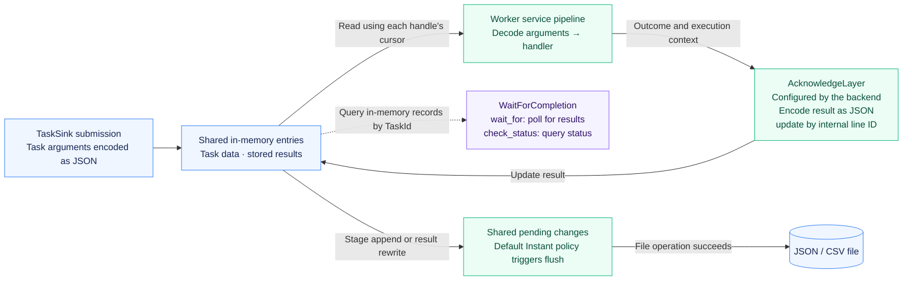
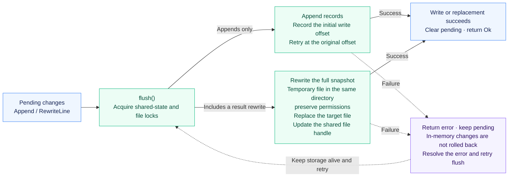

<p align="center">
  
</p>

<h1 align="center">miju-file-storage</h1>

<br />

<div align="center">
  <a href="README.zh-CN.md">简体中文</a>
</div>

<br />

File-backed task storage implementing the backend contracts in `miju-core`.
`JsonStorage<Args>` stores JSON records, while `CsvStorage<Args>` uses a flattened
CSV representation. Both use the JSON codec for task arguments.

## Usage

```rust,no_run
use miju_core::{backend::TaskSink, worker::builder::WorkerBuilder};
use miju_file_storage::JsonStorage;

#[tokio::main(flavor = "current_thread")]
async fn main() -> Result<(), Box<dyn std::error::Error>> {
    let mut storage = JsonStorage::<u32>::new_temp()?;
    storage.push(42).await?;
    let worker = WorkerBuilder::new("file-worker")
        .backend(storage)
        .build(|value: u32| async move { value + 1 });
    worker.run().await?;
    Ok(())
}
```

Workers remain active while waiting for more tasks. Use the worker context or a
controller to stop them when appropriate.

## Storage and Completion

`FileStorage<Args, A>` accepts a record `Adapter`. `JsonAdapter` and `CsvAdapter`
provide the built-in formats. Tasks can be pushed through `TaskSink`; the backend
adds a line identifier to execution metadata and acknowledgement stores the
handler result. `WaitForCompletion` exposes result polling and status queries.

### Task execution and result visibility

This diagram describes a directly configured `FileStorage` backend. Task arguments
use the JSON codec; the record adapter determines the outer JSON or CSV file format.



Clones share `entries`, `pending`, and the active file handle, but each handle
has its own read cursor. They do not claim tasks exclusively. The backend's
acknowledgement layer converts the handler outcome to JSON, representing errors
as strings, and calls `set_result` using the internal line identifier.

`WaitForCompletion` reads shared in-memory records rather than reopening the file.
`wait_for` polls at 100 ms intervals and can keep waiting for an unknown ID.
`check_status` omits unknown IDs, reports records without results as `Pending`,
and classifies stored successful or failed results as `Done` or `Failed`.
These states do not track the worker's live `Running` state.

Memory updates precede flushing. A result can remain visible even if its file
write fails, so finding a result does not establish successful file persistence.

`new` and `try_new` load existing records and results without truncating the
file. Invalid records return an error without changing its contents. Each new
instance starts reading at the first record, including records with results.
`new_temp` retains the temporary file's restrictive permissions and removes it
when the last storage clone is dropped.

New CSV files store each result in a fixed `result_v1` column: hexadecimal UTF-8
JSON containing an empty array for a pending task or a one-element array for a
stored result. This preserves result types and keeps successful, failed and
pending records distinct across rewrites and reopening. Invalid encoded cells
return an error. Older versions of this crate cannot read these result cells.
Existing CSV files without this column retain their legacy read/write format;
they are not upgraded, and their known result-recovery limitations remain.

### File flushing and retries



With appends only, the writer records the initial offset and retries at that
offset. If any result rewrite is pending, flushing writes the complete snapshot
to a securely created temporary file in the same directory, preserves permissions, replaces the
target, and updates the shared file handle.

Only successful flushing clears `pending`. Failure retains pending changes and
does not roll back in-memory updates; it also does not guarantee that the file
was left unchanged. Keep the storage alive, resolve the error, and retry `flush`.
File operations are synchronous. Flushing does not sync the file or directory
to durable media, and dropping storage does not flush pending changes.

Appending a task wakes waiting readers.

`SharedJsonStore` creates typed `MemoryStorage` handles backed by one temporary
JSON store. It separates streams by task type metadata. These handles use the
memory backend's execution contract; they do not provide the file backend's
completion acknowledgement middleware.

## Current Limitations

This backend is intended for development, testing, and low-volume workloads.
File operations are synchronous, including those invoked through async traits.

- Use a private, trusted storage directory. External changes to the file or its
  directory are not coordinated with the in-memory state.
- New instances use immediate flushing. `SyncPolicy` also describes periodic
  and manual policies, but the public API currently has no policy setter.
- Clones have independent read cursors and do not implement exclusive task
  claiming. Independently opening the same path does not share in-memory state
  or file-handle replacement; use one storage and its clones per file.
- Concurrent operations on clones can return `WouldBlockLock`. An I/O failure
  can occur after a mutation is staged in memory; retry `flush` to persist it.
- Flushing does not sync the file or directory to durable media. Cross-process
  coordination, crash or power-loss recovery, and exactly-once execution are
  not provided. Dropping storage does not flush pending changes.
- The CSV adapter splits on commas without quoting or escaping. Its flattened
  arguments and metadata do not preserve all JSON types, keys, or changing schemas.
  Prefer JSON for structured data. CSV is not a general-purpose interchange
  format in this implementation.
- Some completion and shared-store error paths can panic or terminate a stream.
  Inputs and stored result types must match the expected task types.

These limitations are retained in this implementation and require separate
changes before use as a durable production queue.
