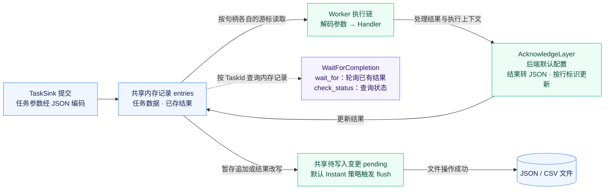
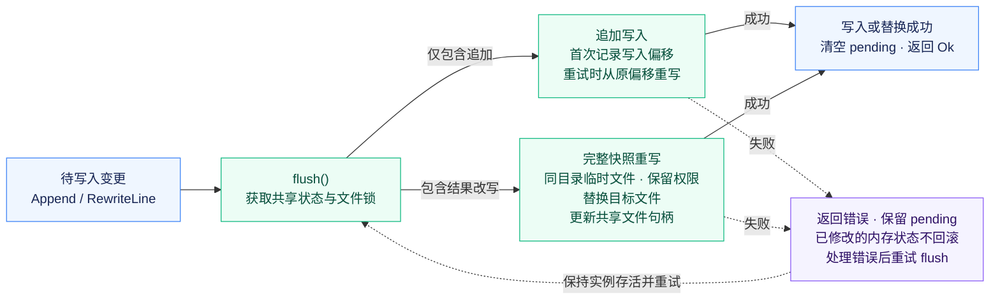

<p align="center">
  
</p>

<h1 align="center">miju-file-storage</h1>

<br />

<div align="center">
  <a href="README.md">English</a>
</div>

<br />

基于文件的任务存储，实现 `miju-core` 的后端契约。
`JsonStorage<Args>` 存储 JSON 记录，`CsvStorage<Args>` 则使用扁平化的 CSV 表示。
两者均使用 JSON 编解码器处理任务参数。

## 使用方式

```rust,no_run
use miju_core::{backend::TaskSink, worker::builder::WorkerBuilder};
use miju_file_storage::JsonStorage;

#[tokio::main(flavor = "current_thread")]
async fn main() -> Result<(), Box<dyn std::error::Error>> {
    let mut storage = JsonStorage::<u32>::new_temp()?;
    storage.push(42).await?;
    let worker = WorkerBuilder::new("file-worker")
        .backend(storage)
        .build(|value: u32| async move { value + 1 });
    worker.run().await?;
    Ok(())
}
```

Worker 在等待更多任务时会保持运行。请在适当时机通过 worker 上下文或控制器停止它们。

## 存储与完成确认

`FileStorage<Args, A>` 接受一个记录 `Adapter`，内置格式由 `JsonAdapter` 和
`CsvAdapter` 提供。任务可通过 `TaskSink` 提交；后端会向执行元数据添加行标识符，
并在完成确认时存储处理器的结果。`WaitForCompletion` 提供结果轮询与状态查询。

### 任务执行与结果可见性

下图描述直接配置 `FileStorage` 后端的路径。任务参数使用 JSON 编解码器；记录适配器决定外层文件采用 JSON 还是 CSV 格式。



克隆共享 `entries`、`pending` 和当前文件句柄，但各自维护读取游标，不提供独占任务领取。
后端的确认层将处理器结果转为 JSON，其中错误表示为字符串，再按内部行标识调用 `set_result`。

`WaitForCompletion` 查询共享内存记录，不会重新打开文件。`wait_for` 每 100 ms 轮询一次，
对于未知 ID 可能持续等待。`check_status` 省略未知 ID，将无结果记录报告为 `Pending`，
并按已存结果的成功或失败分类为 `Done` 或 `Failed`。这些状态不跟踪 Worker 实时的 `Running` 状态。

内存更新发生在刷新之前。即使文件写入失败，结果仍可能可见，因此查询到结果不代表已经成功写入文件。

`new` 和 `try_new` 加载现有记录及结果，不会截断文件。
遇到无效记录时会返回错误，不改变文件内容。每个新实例都会从第一条记录开始读取，
包括已有结果的记录。`new_temp` 保留临时文件的严格访问权限，
并在最后一个存储克隆被释放时删除该文件。

新建 CSV 文件将每个结果存入固定的 `result_v1` 列：将 UTF-8 JSON 转为十六进制表示，
其中空数组表示待处理任务，单元素数组表示已存储的结果。
这种表示保留结果类型，并在重写和重新打开文件后仍能区分成功、失败与待处理记录。
无效的编码单元格会返回错误。此 crate 的旧版本无法读取这些结果单元格。
不含此列的现有 CSV 文件继续使用旧版读写格式，不会自动升级，
其已知的结果恢复限制也仍然存在。

### 文件刷新与重试



仅有追加时，写入器记录初始偏移，重试时从该偏移重写。只要存在结果改写，刷新就会将完整快照写入同目录安全创建的临时文件，保留权限，替换目标文件并更新共享文件句柄。

仅在刷新成功后才清空 `pending`。失败时保留待写入变更，不回滚内存更新，也不保证文件内容完全未变。
应保持存储实例存活，处理错误后重试 `flush`。文件操作同步执行；刷新不会将文件或目录同步到持久介质，释放实例也不会刷新待写入变更。

追加任务会唤醒等待中的读取者。

`SharedJsonStore` 基于一个临时 JSON 存储创建类型化的 `MemoryStorage` 句柄，
通过任务类型元数据区分不同的流。这些句柄采用内存后端的执行契约，
不提供文件后端的完成确认中间件。

## 当前限制

此后端面向开发、测试和低负载场景。文件操作是同步的，包括通过异步 trait 调用的文件操作。

- 应使用私有且可信的存储目录。外部对文件或其目录的修改不会与内存状态协调。
- 新实例采用立即刷新策略。`SyncPolicy` 也描述了定期与手动策略，
  但公共 API 当前不提供设置策略的方法。
- 克隆各自维护独立的读取游标，不实现独占任务领取。独立打开同一路径的实例之间
  不共享内存状态，也不会协调文件句柄替换；每个文件应使用一个存储实例及其克隆。
- 克隆上的并发操作可能返回 `WouldBlockLock`。变更暂存到内存后仍可能发生 I/O 错误；
  应重试 `flush` 将其写入存储。
- 刷新不会将文件或目录同步到持久介质。不提供跨进程协调、崩溃或断电恢复，
  也不保证任务恰好执行一次。释放存储实例不会刷新待写入变更。
- CSV 适配器按逗号拆分，不支持引号或转义。扁平化后的参数与元数据无法保留
  所有 JSON 类型、键或变化的结构。结构化数据应优先使用 JSON；
  此实现中的 CSV 并不是通用交换格式。
- 部分完成处理和共享存储的错误路径可能 panic 或终止流。
  输入与已存储结果的类型必须符合预期任务类型。

这些限制仍保留在当前实现中；在用作持久化生产队列之前，需要单独改进相关实现。
